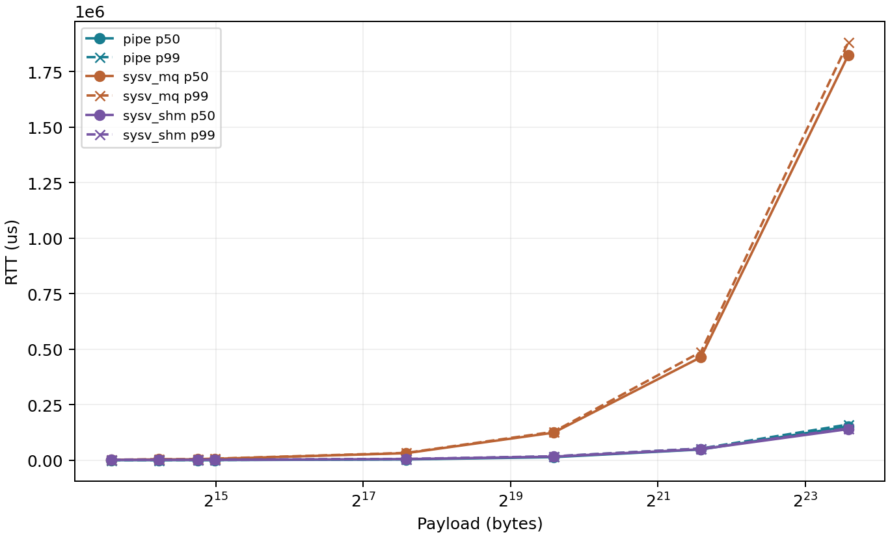
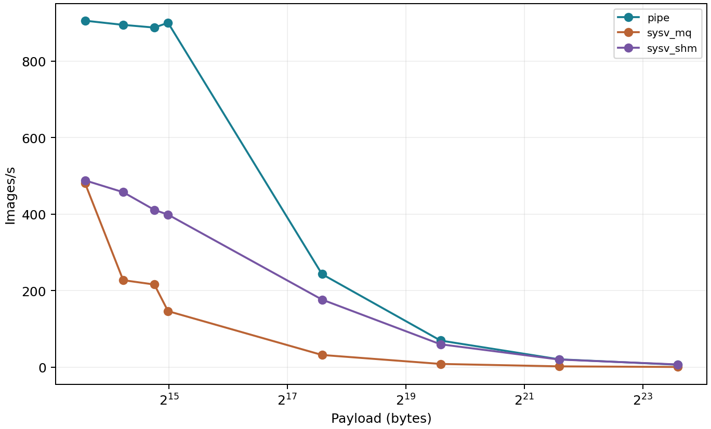
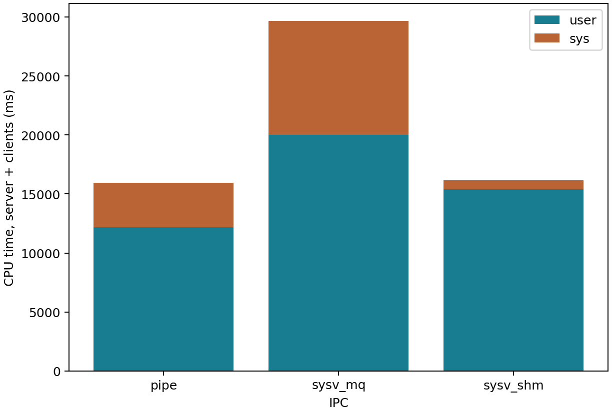
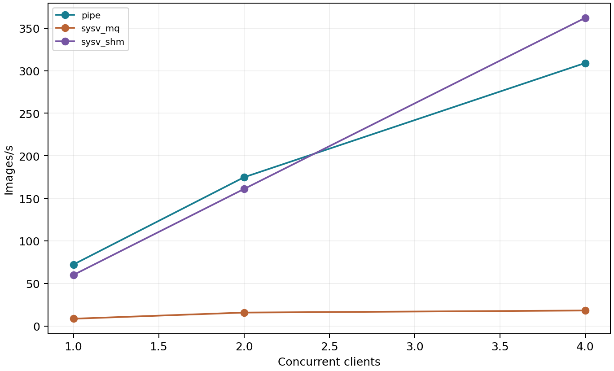
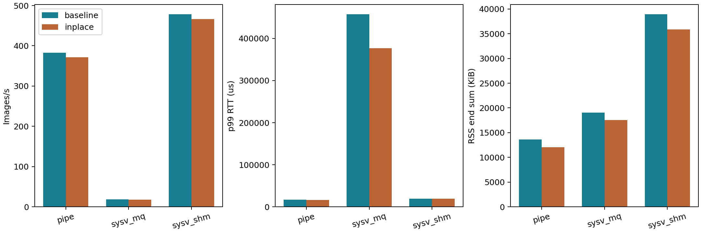

# 2단계 응용 측정과 개선 비교 — IPC Filter Farm

2026-11-19~20(한국 시각)에 현재 검증본의 클린 빌드(`build.log`·`binaries.sha256` 보존)로 S1~S4·S5 기본 용량과 GRAY 버퍼 재사용 전후 비교를 정식 재측정하고, 2026-11-20에 로컬 전수 검증했다. 비대화형 `sudo` 권한 제약이 있는 별도 S5 기본/확대 3쌍(6,000표본)은 2026-11-13 검증 자료를 유지한다. 예측 원문은 [IPC 구현·성능 예측](ipc-prediction.md)에 보존한다.

[R3 정정·진단 한계](diagnostics-measurement.md#r3-공정성-판정)를 적용한 전체 구현 경로 성능이며 순수 IPC 비용은 아니다.

## 측정 조건과 근거

| 항목 | 기록 |
| --- | --- |
| 서버·원본 | `ce22b035@computer.tukorea.ac.kr:22000`의 `/home/student/cestudent/22/ce22b035/ipcff-remeasure-20261119/` 아래 `app-run/`, `improvement-run/` |
| 환경 기록 시각 | 개선 `2026-11-19T08:52:06Z`(한국 17:52:06), 응용 `2026-11-19T12:03:01Z`(한국 21:03:01, 완료 11-20 01:22 KST). 예측 작성 시각으로 소급하지 않는다. |
| 환경 | Ubuntu 24.04.5 LTS·Linux `6.8.0-149-generic`·GCC 13.3.0, Xeon Bronze 3106·16코어, governor `powersave`, affinity `0–15` |
| 고정 조건 | 워밍업 100회·클라당 측정 1,000회·3회 반복, workers=2·team=1, `--quiet`·`--no-save` |
| 실험 조합 | S1 72회·S2 27회·S3 27회·S4 27회·S5 기본 3회 = 응용 156회, 개선 18회 |
| 검증한 샘플 | 응용 219,000건, 개선 36,000건. 워밍업 샘플은 제외했다. |
| MQ 용량 | 이번 응용 실행의 요청·응답 큐는 `msg_qbytes=16384`다. 비대화형 `sudo` 부재로 확대를 재실행하지 않았고, [별도 S5 비교(2026-11-13)](#s5-mq-큐-용량) 자료를 유지한다. |

아래 표는 [측정·집계 정의](03-tech/01-architecture.md#측정과-집계)에 따른 실행별 지표의 3회 중앙값이다.

[응용 중앙값 CSV](assets/app-measurement/app-median.csv)·[응용 환경](assets/app-measurement/app-environment.txt), [개선 중앙값 CSV](assets/app-measurement/improvement-median.csv)·[개선 환경](assets/app-measurement/improvement-environment.txt)에 전체 지표를 첨부했다. 전 원자료는 Git 제외 경로인 로컬 `bench/results/app-run/`과 `bench/results/improvement-run/`에 복사했다(기존 11-13 자료는 `bench/results/archive-20261113/` 보존). 원본 해시 2,026개·279개와 파생 파일 포함 보존 해시 2,033개·283개를 확인했으며 보존 목록은 각각 `bench/results/app-run-preservation.SHA256SUMS`, `bench/results/improvement-run-preservation.SHA256SUMS`다.

두 측정의 `source.tar` SHA-256은 동일하며, 측정 직전 클린 빌드 로그(`bench/results/remeasure-20261119/build.log`)와 바이너리 해시(`binaries.sha256`)를 함께 보존했다.

```text
18ecd19b728cc8aba6cc2b890bcd8b794d9e84dc4d0e63e3ff9275ce8e101d93
```

## S1: 이미지 크기와 지연·처리량

클라 1·GRAY·W=1이다. 각 칸은 **p50 / p99 RTT(µs) / images/s**다.

| 한 변(px) | pipe | sysv_mq | sysv_shm |
| --- | --- | --- | --- |
| 64 | 535.401 / 650.773 / 905.643 | 1,525.591 / 2,467.920 / 480.830 | 1,537.010 / 2,472.400 / 488.228 |
| 80 | 646.570 / 786.313 / 894.712 | 3,881.771 / 4,869.847 / 227.416 | 1,661.552 / 2,618.638 / 457.405 |
| 96 | 841.636 / 957.742 / 887.631 | 4,087.191 / 5,040.772 / 216.085 | 1,886.330 / 2,833.477 / 411.181 |
| 104 | 859.686 / 1,073.698 / 900.250 | 6,383.180 / 7,368.524 / 146.462 | 1,933.252 / 2,877.932 / 398.712 |
| 256 | 3,625.831 / 4,682.461 / 243.181 | 31,842.764 / 33,239.857 / 31.947 | 5,127.978 / 6,136.990 / 176.663 |
| 512 | 13,967.427 / 17,417.291 / 69.629 | 124,103.303 / 128,162.029 / 8.508 | 16,270.002 / 17,794.833 / 59.857 |
| 1024 | 48,561.168 / 52,913.935 / 20.618 | 464,094.900 / 487,768.324 / 2.165 | 49,669.091 / 52,671.579 / 19.987 |
| 2048 | 152,152.215 / 161,114.889 / 6.528 | 1,824,282.848 / 1,881,838.229 / 0.548 | 140,255.076 / 143,965.618 / 7.101 |





작은 이미지에서는 pipe가 유리했다. 64²에서 MQ와 SHM은 p50·p99가 거의 같고 처리량은 SHM이 근소하게 높았으며, 80² 이상에서는 MQ의 p50·p99가 가장 높고 처리량이 가장 낮았다. 512²·1024²에서는 pipe가 근소 우세했고, 2048²에서는 SHM이 pipe보다 약 8.8% 높았다. 큰 이미지라도 W=1에서 항상 SHM이 우세하다는 가설은 지지하지 않는다.

S1 512²의 자원 합계는 다음과 같다.

| IPC | user / sys CPU(ms) | 자발적 / 비자발적 전환 | 시작 / 종료 RSS(KiB) |
| --- | --- | --- | --- |
| pipe | 12,166.449 / 3,779.324 | 19,344 / 53 | 9,108 / 9,240 |
| sysv_mq | 20,020.715 / 9,655.853 | 364,446 / 82 | 9,904 / 10,920 |
| sysv_shm | 15,408.340 / 744.354 | 41,667 / 51 | 11,504 / 11,628 |



SHM은 pipe보다 sys CPU가 약 1/5 수준으로 낮았지만 user CPU·RSS는 높았다. 이 차이는 IPC 경로·동기화 비용과 부합하는 관찰이며 각 원인의 기여율을 분리한 결과는 아니다.

## S2: 클라이언트 수

512²·GRAY·클라당 W=1의 전체 images/s다.

| IPC | 클라 1 | 클라 2 | 클라 4 |
| --- | ---: | ---: | ---: |
| pipe | 72.231 | 174.734 | 308.990 |
| sysv_mq | 8.483 | 15.724 | 18.145 |
| sysv_shm | 59.988 | 160.964 | 361.998 |



4클라에서 SHM은 pipe보다 약 17.2% 높았다. 1→4클라에서 pipe(4.28배)·SHM(6.03배)은 4배를 넘는 증가를 보였으므로 이 응용 조건에서 단순 비례 이하만 예상한 보완 가설과 달랐다. 미완료 요청 수 증가가 공통 파이프라인의 유휴 시간을 줄였을 가능성은 있으나 원인을 확정하지 않는다. MQ는 2→4클라에서 증가폭이 작고 p99는 189,511→387,253µs로 늘었다.

## S3: 필터 연산 비용

512²·클라 2·W=1의 전체 images/s다.

| IPC | GRAY | BLUR | EDGE |
| --- | ---: | ---: | ---: |
| pipe | 182.649 | 98.311 | 55.026 |
| sysv_mq | 15.607 | 14.715 | 13.682 |
| sysv_shm | 155.841 | 97.271 | 54.990 |

pipe/SHM 처리량 비는 GRAY 약 1.172배에서 EDGE 약 1.001배(차이 0.07%)로 사실상 사라졌다. pipe/MQ 비도 약 11.70배에서 4.02배로 줄었지만 MQ는 여전히 크게 뒤처졌다. 연산량이 늘수록 상대 IPC 차이가 희석된다는 가설과 부합하며, MQ의 구조적 열세는 남았다.

## S4: 파이프라인 깊이

512²·클라 1·GRAY다. 각 칸은 **images/s / p99 RTT(µs) / 종료 RSS 합계(KiB)**다.

| IPC | W=1 | W=4 | W=16 |
| --- | --- | --- | --- |
| pipe | 76.158 / 17,056.882 / 9,240.000 | 346.658 / 13,896.807 / 11,540.000 | 347.057 / 13,656.816 / 11,552.000 |
| sysv_mq | 8.372 / 128,464.566 / 10,920.000 | 18.162 / 236,737.559 / 12,460.000 | 18.214 / 264,398.940 / 12,464.000 |
| sysv_shm | 60.182 / 17,892.298 / 11,624.000 | 408.454 / 11,887.168 / 23,144.000 | 467.644 / 42,975.403 / 60,012.000 |

W=4에서 pipe·SHM 모두 처리량이 크게 늘었고, SHM(408.454 img/s)이 pipe(346.658)보다 약 17.8% 앞섰다. W=16에서는 pipe 처리량이 정체됐고, SHM은 W=4→16에서 약 14.5% 더 처리했지만 p99는 약 3.62배, 종료 RSS는 약 2.59배였다. 이 조건에서 처리량을 우선하면 SHM W=16, 지연·메모리를 함께 고려하면 W=4가 비교 후보가 된다. S1·S2·S4의 W=1은 별도 실행이므로 동일 조건의 실행 간 변동도 함께 고려한다.

## S5: MQ 큐 용량

이번 `app-run`에서는 기본 용량(`16,384B`, 3회 중앙값 `2.146 img/s`, `p50 468,999µs`, `p99 489,131µs`)만 실행했으며, 확대 비교는 비대화형 `sudo` 제약으로 2026-11-13에 `run_bench.sh s5`로 측정한 **1024²·클라 1·GRAY·W=1·workers=2·워밍업 100·측정 1,000회·기본→확대 3쌍** 자료를 유지한다.

| 지표: 실행별 3회 중앙값 (2026-11-13) | 16,384B | 65,536B | 변화 |
| --- | ---: | ---: | ---: |
| images/s | 2.133994 | 6.632835 | +210.82% (약 3.11배) |
| p50 RTT(µs) | 474,679.634 | 153,500.681 | −67.66% |
| p99 RTT(µs) | 494,581.271 | 166,605.785 | −66.31% |
| user CPU 합계(ms) | 69,104.876 | 57,748.018 | −16.43% |
| sys CPU 합계(ms) | 46,627.519 | 19,276.568 | −58.66% |
| 자발적 컨텍스트 스위치 | 1,436,805 | 426,380 | −70.32% |
| 종료 RSS 합계(KiB) | 31,676 | 31,676 | 0.00% |

처리량 범위는 기본 2.104061–2.136786, 확대 6.628471–6.688542 images/s로 겹치지 않았다. 큐 용량만 바꾼 대조에서 처리량·지연·sys CPU·자발적 전환이 함께 개선돼, 이 구현·조건에서 큐 용량 확대의 효과를 관찰했다. 이는 큐 백프레셔가 성능에 영향을 준다는 설명과 부합한다. 청크 크기와 재시도 간격은 바꾸지 않았으므로 청크 분할 자체나 `ipc_nap`의 1ms 대기를 확정된 원인으로 분리하지 않는다. 시스템 콜 요약은 [별도 진단](diagnostics-measurement.md#시스템-콜-비교)을 따르며 대기·복사·체크섬 각각의 기여율도 미확인이다.

RSS가 같아도 커널 큐 비용이 같다는 뜻은 아니다. 요청·응답 큐의 설정 용량 합계는 96KiB 증가했으며 이는 실제 점유량·물리 메모리 증가 실측이 아니다. 3쌍 모두 기본→확대 순서이고 공유 서버의 부하·governor를 고정하지 않았으므로 시간 순서 효과와 통계적 유의성은 확정하지 않는다.

[실행별 CSV](assets/app-measurement/s5-comparison.csv)·[중앙값 CSV](assets/app-measurement/s5-comparison-median.csv)·[환경](assets/app-measurement/s5-environment.txt)·[종료 확인](assets/app-measurement/s5-postcheck.txt)을 첨부했다. 환경 기록은 `2026-11-13T06:56:50Z`, 종료 확인 기록은 `2026-11-13T07:31:24Z`이며 실행 시작·종료 시각으로 소급하지 않는다. 서버와 로컬의 `bench/results/s5-comparison-run/`에 원자료·소스 스냅샷·해시를 보존했다. 이 경로는 Git 제외 대상에서 해제했으며, [보존 해시 목록](../bench/results/s5-comparison-run/preservation.SHA256SUMS)과 [재계산 도구](../bench/results/s5-comparison-run/analyze.py)를 함께 저장소에 포함한다.

`python3 bench/results/s5-comparison-run/analyze.py`의 [검증 로그](../tests/logs/s5-measurement.log)는 6회·6,000표본의 seq·ID·페이로드·matched 로그, 모든 RTT·자원 지표의 독립 재계산, stderr 공백·본인 IPC 부재를 확인했다. 모든 실행의 생성된 요청·응답 큐를 `IPC_STAT`으로 조회해 기본 16,384B·확대 65,536B를 확인했다. 확대 뒤 기본값 복원 3회와 최종 `kernel.msgmnb=16384`, 잔존 MQ·SHM·SEM 부재도 확인했다.

## 단일 요인 개선: GRAY 입력 버퍼 재사용

512²·클라 2·GRAY·W=4에서 `--inplace-gray`만 변경했다. BLUR/EDGE는 대상이 아니다.

| IPC | images/s | p99 RTT(µs) | 종료 RSS 합계(KiB) |
| --- | --- | --- | --- |
| pipe | 382.437 → 371.620 (-2.83%) | 16,831.019 → 16,773.222 (-0.34%) | 13,636.000 → 12,084.000 (-11.38%) |
| sysv_mq | 18.809 → 18.205 (-3.21%) | 457,483.697 → 376,598.770 (-17.68%) | 19,068.000 → 17,528.000 (-8.08%) |
| sysv_shm | 478.474 → 466.572 (-2.49%) | 19,632.726 → 19,817.661 (+0.94%) | 38,940.000 → 35,872.000 (-7.88%) |



종료 RSS 중앙값은 pipe 1,552KiB·MQ 1,540KiB·SHM 3,068KiB 감소했다. 이는 프로세스 경계 RSS의 관찰값이며, worker 출력 버퍼 용량 계산인 1.5MiB와 직접 같다고 해석하지 않는다. MQ의 3회차는 종료 RSS가 baseline 16,260KiB→inplace 17,532KiB여서 감소가 모든 반복에 나타난 것은 아니다.

처리량 중앙값은 세 IPC 모두 소폭 낮아졌으며, 반복 범위는 pipe(baseline 380.792–382.839 vs inplace 365.808–382.411), MQ(17.880–19.460 vs 17.694–18.375), SHM(474.574–478.991 vs 459.894–479.349) 모두 서로 겹쳤다. 따라서 이 개선은 메모리 절감 근거는 있지만 속도 개선으로 채택할 근거는 없다. 반복 수가 3이고 baseline→inplace 순서가 고정되어 있으므로 성능 차이의 인과·통계적 유의성은 확정하지 않는다.

전체 user/sys CPU·컨텍스트 스위치·시작 RSS·나머지 지연 지표는 첨부 CSV에서 비교한다. 버퍼 재사용은 필터와 IPC 복사·체크섬을 제거하지 않는다. GRAY 동등성은 [기존 단위 검증](04-test/01-verification.md#현재-검증-판정)으로 구분한다.

## 예측 대조와 IPC 선택

| 예측 | 관찰과 적용 범위 |
| --- | --- |
| 대형 GRAY에서 SHM > pipe > MQ | W=1의 512²·1024²에서는 pipe가 근소 우세했으나, 2048²(+8.8%) 및 512² W=4/16(+17.8%)·4클라(+17.2%)에서는 SHM이 크게 앞섰다. 크기·동시 요청 조건을 함께 지정해야 한다. |
| 연산 비용 증가 시 IPC 차이 희석 | S3에서 pipe/SHM 비가 1.172→1.001로 줄었지만 MQ의 열세는 남았다. |
| W 증가 시 처리량 증가·메모리 비용 | S4에서 W=4의 이점이 컸고 W=16의 추가 이점은 SHM에만 나타났다(+14.5%). SHM은 지연(3.62배)·RSS(2.59배) 비용도 커졌다. |
| 버퍼 재사용 시 메모리 절감·속도 효과는 작을 수 있음 | RSS 중앙값은 감소했으나 처리량 향상은 관찰하지 못했다. |
| 큐 확대 시 MQ 대기 완화 | 별도 S5 3쌍(2026-11-13)에서 처리량 약 3.11배, p99 약 66.3% 감소와 자발적 전환 감소를 관찰했다. 해당 구현·큐 용량 조건에 한정한다. |

기존 관찰값에서는 작은 이미지·단일 요청 지연에 pipe, 큰 GRAY·동시 처리량에 SHM이 후보가 된다. 선택은 이 구현·서버·워크로드 조건에 한정한다. MQ는 메시지 경계·타입의 편의와 별개로 이번 이미지 페이로드에서 처리량이 낮았다. 이는 해당 구현과 서버의 결과이며 IPC 방식 전체의 보편 순위가 아니다.

## 검증 판정과 남은 확인

[2026-11-19~20 Linux 검증·재측정 로그](../tests/logs/linux-remeasure-20261119.log)에 검사 범위를 기록했다. 원격·로컬 `bench/check_results.sh`는 기초·응용·개선 자료의 해시·최소 조합·그래프 존재 검사를 통과했고, 로컬 전수 검증에서 응용 156회(219,000표본)·개선 18회(36,000표본)의 클라 matched 로그, stderr 공백, 실행 후 본인 `ipcs` 잔존 0건을 확인했다. 클린 빌드 로그(`build.log`)와 실행 바이너리 해시(`binaries.sha256`)도 함께 보존했다.

공정성·제어 I/O 해석은 [진단 결과](diagnostics-measurement.md)를 따른다. 제출물 최종 확정은 [남은 작업](03-tech/01-architecture.md#남은-작업과-리스크)을 따른다.
