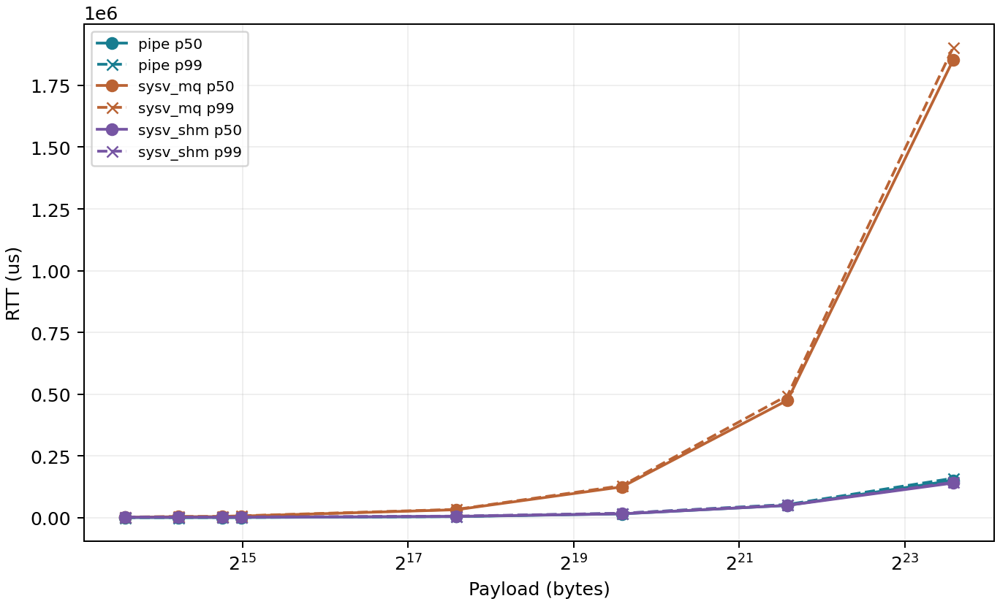
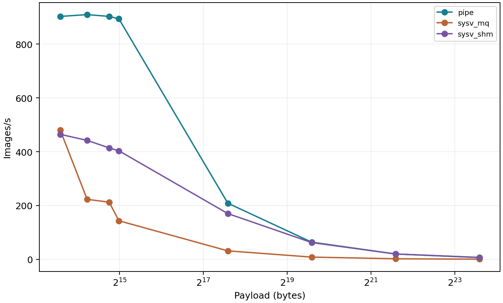
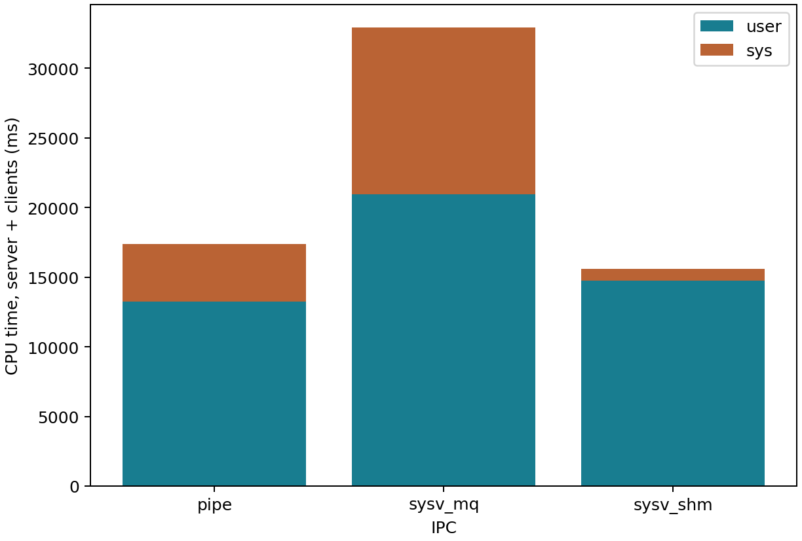
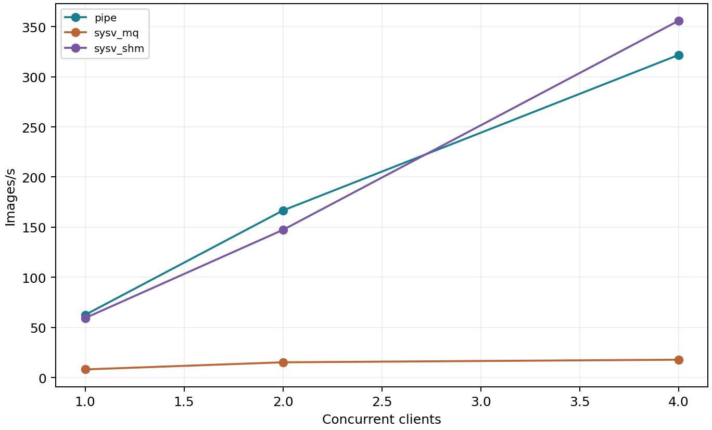
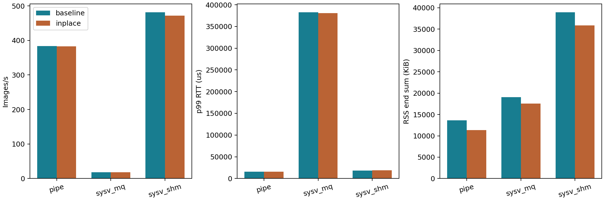

# 2단계 응용 측정과 개선 비교 — IPC Filter Farm

2026-11-13(한국 시각)에 서버 산출물을 보존·검증했다. S1~S4와 S5 기본 용량, GRAY 버퍼 재사용 전후 비교의 원자료·집계·그래프를 확인했다. 별도 S5 기본/확대 3쌍의 6,000표본도 검증했다. 예측 원문은 [IPC 구현·성능 예측](ipc-prediction.md)에 보존한다.

[R3 정정·진단 한계](diagnostics-measurement.md#r3-공정성-판정)를 적용한 전체 구현 경로 성능이며 순수 IPC 비용은 아니다.

## 측정 조건과 근거

| 항목 | 기록 |
| --- | --- |
| 서버·원본 | `ce22b035@computer.tukorea.ac.kr:22000`의 `/home/student/cestudent/22/ce22b035/sp-ipc-filter-farm/bench/results/` 아래 `app-run/`, `improvement-run/` |
| 환경 기록 시각 | 응용 `2026-11-13T02:08:28Z`(한국 11:08:28), 개선 `2026-11-13T01:53:01Z`(한국 10:53:01). 실행 시작·종료나 예측 작성 시각으로 소급하지 않는다. |
| 환경 | Ubuntu 24.04.5 LTS·Linux `6.8.0-147-generic`·GCC 13.3.0, Xeon Bronze 3106·16코어, governor `powersave`, affinity `0–15` |
| 고정 조건 | 워밍업 100회·클라당 측정 1,000회·3회 반복, workers=2·team=1, `--quiet`·`--no-save` |
| 실험 조합 | S1 72회·S2 27회·S3 27회·S4 27회·S5 기본 3회 = 응용 156회, 개선 18회 |
| 검증한 샘플 | 응용 219,000건, 개선 36,000건. 워밍업 샘플은 제외했다. |
| MQ 용량 | 원래 응용 실행의 요청·응답 큐는 `msg_qbytes=16384`다. 이 실행에서는 `S5_MSGMNB` 미설정으로 확대를 실행하지 않았고, [별도 S5 비교](#s5-mq-큐-용량)에서 확대를 측정했다. |

아래 표는 [측정·집계 정의](03-tech/01-architecture.md#측정과-집계)에 따른 실행별 지표의 3회 중앙값이다.

[응용 중앙값 CSV](assets/app-measurement/app-median.csv)·[응용 환경](assets/app-measurement/app-environment.txt), [개선 중앙값 CSV](assets/app-measurement/improvement-median.csv)·[개선 환경](assets/app-measurement/improvement-environment.txt)에 전체 지표를 첨부했다. 전 원자료는 Git 제외 경로인 로컬 `bench/results/app-run/`과 `bench/results/improvement-run/`에 복사했다. 원본 해시 2,026개·279개와 파생 파일 포함 보존 해시 2,033개·283개를 확인했으며 보존 목록은 각각 `bench/results/app-run-preservation.SHA256SUMS`, `bench/results/improvement-run-preservation.SHA256SUMS`다.

두 측정의 `source.tar` SHA-256은 동일하다.

```text
57ce280f5a392eaa68f0db925fad16505ea4421e310ea5e00264bd75c161a1f3
```

스냅샷의 `src/`, `Makefile`과 측정·집계·그래프·제출검사 도구는 검증 당시 로컬 파일과 바이트가 일치했다. 별도 빌드 로그가 없으므로 실행 바이너리와 소스의 대응을 이 사실만으로 확정하지 않는다.

## S1: 이미지 크기와 지연·처리량

클라 1·GRAY·W=1이다. 각 칸은 **p50 / p99 RTT(µs) / images/s**다.

| 한 변(px) | pipe | sysv_mq | sysv_shm |
| --- | --- | --- | --- |
| 64 | 586.843 / 670.611 / 902.842 | 1,523.600 / 2,600.288 / 480.930 | 1,595.051 / 2,504.929 / 464.567 |
| 80 | 669.868 / 758.467 / 909.545 | 3,928.380 / 4,953.240 / 222.946 | 1,675.639 / 2,659.235 / 442.140 |
| 96 | 820.393 / 976.297 / 902.895 | 4,163.757 / 5,111.415 / 212.535 | 1,863.461 / 2,791.519 / 414.091 |
| 104 | 872.286 / 1,056.119 / 893.988 | 6,454.841 / 7,516.232 / 143.354 | 1,926.892 / 2,968.242 / 403.411 |
| 256 | 4,559.443 / 4,919.013 / 208.715 | 32,261.609 / 33,628.092 / 31.536 | 5,310.450 / 6,233.867 / 170.085 |
| 512 | 15,587.036 / 17,643.935 / 63.887 | 124,718.724 / 129,588.689 / 8.353 | 15,805.179 / 17,996.783 / 62.398 |
| 1024 | 49,761.368 / 53,384.783 / 19.893 | 475,445.971 / 494,578.019 / 2.120 | 49,732.618 / 51,450.375 / 19.892 |
| 2048 | 150,958.420 / 159,621.424 / 6.587 | 1,852,629.156 / 1,902,834.694 / 0.542 | 140,301.022 / 143,135.571 / 7.100 |





작은 이미지에서는 pipe가 유리했다. MQ는 64²에서 SHM보다 p50이 낮고 처리량이 높았지만 p99는 높았다. MQ와 SHM의 p50·처리량 순위는 64²와 80² 사이에서 바뀌었으며, 측정한 80² 이상에서는 MQ의 p50·p99가 가장 높고 처리량이 가장 낮았다. 정확한 역전 크기는 미확정이다. 1024²에서 pipe와 SHM의 처리량 중앙값은 사실상 같고, 2048²에서는 SHM이 pipe보다 약 7.8% 높았다. 큰 이미지라도 W=1에서 항상 SHM이 우세하다는 가설은 지지하지 않는다.

S1 512²의 자원 합계는 다음과 같다.

| IPC | user / sys CPU(ms) | 자발적 / 비자발적 전환 | 시작 / 종료 RSS(KiB) |
| --- | --- | --- | --- |
| pipe | 13,252.159 / 4,148.292 | 20,652 / 67 | 9,116 / 9,248 |
| sysv_mq | 20,955.253 / 11,999.598 | 364,245 / 101 | 9,916 / 10,932 |
| sysv_shm | 14,754.905 / 840.257 | 39,397 / 35 | 11,512 / 11,636 |



SHM은 pipe보다 sys CPU가 낮았지만 user CPU·RSS는 높았다. 이 차이는 IPC 경로·동기화 비용과 부합하는 관찰이며 각 원인의 기여율을 분리한 결과는 아니다.

## S2: 클라이언트 수

512²·GRAY·클라당 W=1의 전체 images/s다.

| IPC | 클라 1 | 클라 2 | 클라 4 |
| --- | --- | --- | --- |
| pipe | 62.620 | 166.653 | 321.618 |
| sysv_mq | 8.228 | 15.325 | 17.905 |
| sysv_shm | 59.430 | 147.303 | 355.735 |



4클라에서 SHM은 pipe보다 약 10.6% 높았다. 1→4클라에서 pipe·SHM은 4배를 넘는 증가를 보였으므로 이 응용 조건에서 단순 비례 이하만 예상한 보완 가설과 달랐다. 미완료 요청 수 증가가 공통 파이프라인의 유휴 시간을 줄였을 가능성은 있으나 원인을 확정하지 않는다. MQ는 2→4클라에서 증가폭이 작고 p99는 215,179→374,530µs로 늘었다.

## S3: 필터 연산 비용

512²·클라 2·W=1의 전체 images/s다.

| IPC | GRAY | BLUR | EDGE |
| --- | --- | --- | --- |
| pipe | 166.023 | 94.921 | 55.035 |
| sysv_mq | 15.333 | 14.666 | 13.401 |
| sysv_shm | 155.597 | 92.924 | 54.032 |

pipe/SHM 처리량 비는 GRAY 약 1.067배에서 EDGE 약 1.019배로 줄었다. pipe/MQ 비도 약 10.83배에서 4.11배로 줄었지만 MQ는 여전히 크게 뒤처졌다. 연산량이 늘수록 상대 IPC 차이가 희석된다는 가설과 부합하며, 모든 차이가 사라진 결과는 아니다.

## S4: 파이프라인 깊이

512²·클라 1·GRAY다. 각 칸은 **images/s / p99 RTT(µs) / 종료 RSS 합계(KiB)**다.

| IPC | W=1 | W=4 | W=16 |
| --- | --- | --- | --- |
| pipe | 72.722 / 17,256.132 / 9,252.000 | 354.810 / 14,302.789 / 11,556.000 | 351.005 / 25,394.918 / 11,560.000 |
| sysv_mq | 8.424 / 130,079.251 / 10,932.000 | 17.596 / 239,704.716 / 12,472.000 | 17.993 / 420,334.128 / 10,432.000 |
| sysv_shm | 59.088 / 17,847.284 / 11,640.000 | 408.723 / 12,630.741 / 23,156.000 | 483.663 / 35,418.615 / 60,024.000 |

W=4에서 pipe·SHM 모두 처리량이 크게 늘었다. W=16에서는 pipe 처리량이 더 늘지 않았고 p99가 높아졌다. SHM은 W=4→16에서 약 18.3% 더 처리했지만 p99는 약 2.80배, 종료 RSS는 약 2.59배였다. 이 조건에서 처리량을 우선하면 SHM W=16, 지연·메모리를 함께 고려하면 W=4가 비교 후보가 된다. S1·S2·S4의 W=1은 별도 실행이므로 동일 조건의 실행 간 변동도 함께 고려한다.

## S5: MQ 큐 용량

원래 응용 실행에는 기본 용량만 있었으므로, `run_bench.sh s5`로 **1024²·클라 1·GRAY·W=1·workers=2·워밍업 100·측정 1,000회·기본→확대 3쌍**을 별도 측정했다. 같은 실행 내 기본 용량을 함께 다시 측정했으며 원래 S5 CSV는 변경하지 않았다.

| 지표: 실행별 3회 중앙값 | 16,384B | 65,536B | 변화 |
| --- | ---: | ---: | ---: |
| images/s | 2.133994 | 6.632835 | +210.82% (약 3.11배) |
| p50 RTT(µs) | 474,679.634 | 153,500.681 | −67.66% |
| p99 RTT(µs) | 494,581.271 | 166,605.785 | −66.31% |
| user CPU 합계(ms) | 69,104.876 | 57,748.018 | −16.43% |
| sys CPU 합계(ms) | 46,627.519 | 19,276.568 | −58.66% |
| 자발적 컨텍스트 스위치 | 1,436,805 | 426,380 | −70.32% |
| 종료 RSS 합계(KiB) | 31,676 | 31,676 | 0.00% |

처리량 범위는 기본 2.104061–2.136786, 확대 6.628471–6.688542 images/s로 겹치지 않았다. 큐 용량만 바꾼 대조에서 처리량·지연·sys CPU·자발적 전환이 함께 개선돼, 이 구현·조건에서 큐 용량 확대의 효과를 관찰했다. 이는 큐 백프레셔가 성능에 영향을 준다는 설명과 부합한다. 청크 크기와 재시도 간격은 바꾸지 않았으므로 청크 분할 자체나 `ipc_nap`의 1ms 대기를 확정된 원인으로 분리하지 않는다. 시스템 콜 요약은 [별도 진단](diagnostics-measurement.md#시스템-콜-비교)을 따르며 대기·복사·체크섬 각각의 기여율도 미확인이다.

RSS가 같아도 커널 큐 비용이 같다는 뜻은 아니다. 요청·응답 큐의 설정 용량 합계는 96KiB 증가했으며 이는 실제 점유량·물리 메모리 증가 실측이 아니다. 3쌍 모두 기본→확대 순서이고 공유 서버의 부하·governor를 고정하지 않았으므로 시간 순서 효과와 통계적 유의성은 확정하지 않는다.

[실행별 CSV](assets/app-measurement/s5-comparison.csv)·[중앙값 CSV](assets/app-measurement/s5-comparison-median.csv)·[환경](assets/app-measurement/s5-environment.txt)·[종료 확인](assets/app-measurement/s5-postcheck.txt)을 첨부했다. 환경 기록은 `2026-11-13T06:56:50Z`, 종료 확인 기록은 `2026-11-13T07:31:24Z`이며 실행 시작·종료 시각으로 소급하지 않는다. 서버와 로컬의 `bench/results/s5-comparison-run/`에 원자료·소스 스냅샷·해시를 보존했다. 이 경로는 Git 제외 대상에서 해제했으며, [보존 해시 목록](../bench/results/s5-comparison-run/preservation.SHA256SUMS)과 [재계산 도구](../bench/results/s5-comparison-run/analyze.py)를 함께 저장소에 포함한다. 실행별 `raw/*/channel.txt`에는 요청·응답 큐의 실제 `msg_qbytes`, `environment.txt`와 `postcheck.txt`에는 설정·원복 기록이 있다. 스냅샷의 소스·빌드·측정 도구 45개가 로컬과 일치했으며 바이너리와 소스의 별도 대응 증명은 기존 한계와 같다.

`python3 bench/results/s5-comparison-run/analyze.py`의 [검증 로그](../tests/logs/s5-measurement.log)는 6회·6,000표본의 seq·ID·페이로드·matched 로그, 모든 RTT·자원 지표의 독립 재계산, stderr 공백·본인 IPC 부재를 확인했다. 모든 실행의 생성된 요청·응답 큐를 `IPC_STAT`으로 조회해 기본 16,384B·확대 65,536B를 확인했다. 조회는 클라 시작 전이며 큐 종료 뒤 조회했다고 주장하지 않는다. 확대 뒤 기본값 복원 3회와 최종 `kernel.msgmnb=16384`, 잔존 MQ·SHM·SEM 부재도 확인했다.

## 단일 요인 개선: GRAY 입력 버퍼 재사용

512²·클라 2·GRAY·W=4에서 `--inplace-gray`만 변경했다. BLUR/EDGE는 대상이 아니다.

| IPC | images/s | p99 RTT(µs) | 종료 RSS 합계(KiB) |
| --- | --- | --- | --- |
| pipe | 383.464 → 382.500 (-0.25%) | 15,647.342 → 15,912.233 (+1.69%) | 13,660.000 → 11,348.000 (-16.93%) |
| sysv_mq | 18.153 → 18.045 (-0.59%) | 382,871.924 → 380,627.480 (-0.59%) | 19,088.000 → 17,560.000 (-8.01%) |
| sysv_shm | 481.820 → 471.562 (-2.13%) | 18,522.219 → 19,076.278 (+2.99%) | 38,972.000 → 35,888.000 (-7.91%) |



종료 RSS 중앙값은 pipe 2,312KiB·MQ 1,528KiB·SHM 3,084KiB 감소했다. 이는 프로세스 경계 RSS의 관찰값이며, worker 출력 버퍼 용량 계산인 1.5MiB와 직접 같다고 해석하지 않는다. MQ의 첫 반복은 종료 RSS가 전후 모두 19,088KiB여서 감소가 모든 반복에 나타난 것도 아니다.

처리량 중앙값은 세 IPC 모두 낮아졌다. pipe는 baseline 381.394–390.768·inplace 380.945–384.834 images/s, MQ는 17.915–18.210·17.917–18.061로 범위가 겹쳤다. SHM은 478.741–484.160→469.730–471.579로 세 반복 모두 낮고 p99 중앙값도 약 3.0% 높았다. 따라서 이 개선은 메모리 절감 근거는 있지만 속도 개선으로 채택할 근거는 없다. 반복 수가 3이고 baseline→inplace 순서가 고정되어 있으므로 성능 저하의 인과·통계적 유의성은 확정하지 않는다.

전체 user/sys CPU·컨텍스트 스위치·시작 RSS·나머지 지연 지표는 첨부 CSV에서 비교한다. 버퍼 재사용은 필터와 IPC 복사·체크섬을 제거하지 않는다. GRAY 동등성은 [기존 단위 검증](04-test/01-verification.md#현재-검증-판정)으로 구분하며, 이번 원자료 검증은 새 픽셀 동등성 실험이 아니다.

## 예측 대조와 IPC 선택

| 예측 | 관찰과 적용 범위 |
| --- | --- |
| 대형 GRAY에서 SHM > pipe > MQ | W=1의 512²에서는 pipe가 앞서고 1024²는 비슷했다. 2048² 및 512² W=4/16·4클라에서는 SHM이 앞섰다. 크기·동시 요청 조건을 함께 지정해야 한다. |
| 연산 비용 증가 시 IPC 차이 희석 | S3에서 상대 차이가 줄었지만 MQ의 열세는 남았다. |
| W 증가 시 처리량 증가·메모리 비용 | S4에서 W=4의 이점이 컸고 W=16의 추가 이점은 IPC별로 달랐다. SHM은 지연·RSS 비용도 커졌다. |
| 버퍼 재사용 시 메모리 절감·속도 효과는 작을 수 있음 | RSS 중앙값은 감소했으나 처리량 향상은 관찰하지 못했다. |
| 큐 확대 시 MQ 대기 완화 | 별도 S5 3쌍에서 처리량 약 3.11배, p99 약 66.3% 감소와 자발적 전환 감소를 관찰했다. 해당 구현·큐 용량 조건에 한정한다. |

기존 관찰값에서는 작은 이미지·단일 요청 지연에 pipe, 큰 GRAY·동시 처리량에 SHM이 후보가 된다. 선택은 이 구현·서버·워크로드 조건에 한정한다. MQ는 메시지 경계·타입의 편의와 별개로 이번 이미지 페이로드에서 처리량이 낮았다. 이는 해당 구현과 서버의 결과이며 IPC 방식 전체의 보편 순위가 아니다.

## 검증 판정과 남은 확인

[산출물 검증 로그](../tests/logs/app-measurement.log)에 검사 범위를 기록했다. 전체 seq·ID·페이로드·클라 matched 로그를 확인하고 RTT 백분위·평균·처리량·CPU·컨텍스트 스위치·RSS를 원자료에서 재계산해 CSV와 대조했다. 반복별 조합·중앙값, stderr 공백, 실행 후 `ipcs` 객체 부재를 확인했다. `bench/check_results.sh`는 기초·응용·개선 자료의 해시·최소 조합·그래프 존재 검사를 통과했다. 성능 측정이나 Linux 회귀 검사를 다시 실행한 것은 아니다.

공정성·제어 I/O 해석은 [진단 결과](diagnostics-measurement.md)를 따른다. 로컬 matplotlib 부재로 그래프를 재생성하지 않았으며 서버 생성본·중앙값 CSV를 보존했다. 제출과 수정본 검증은 [남은 작업](03-tech/01-architecture.md#남은-작업과-리스크)을 따른다.
