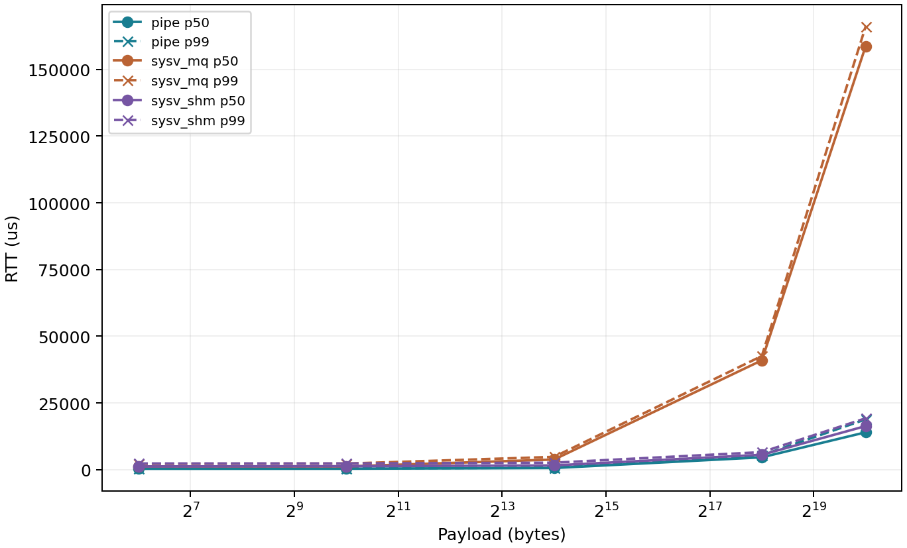
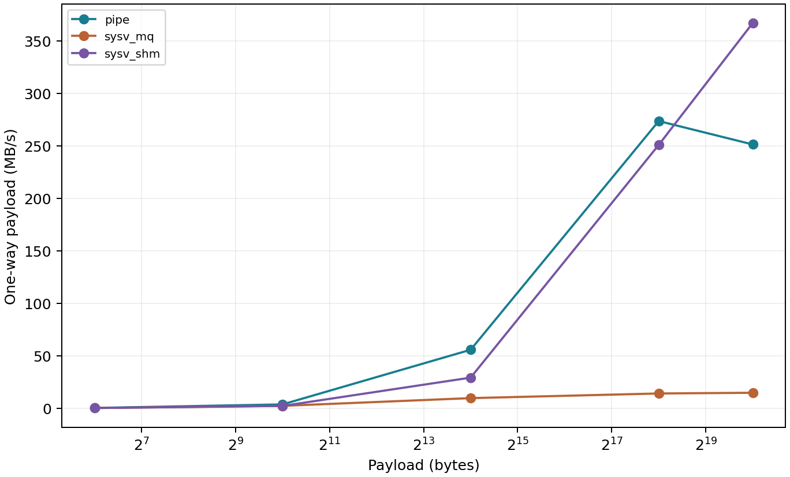

# 1단계 기초 측정 결과 — IPC Filter Farm

2026-11-19에 현재 검증본(`make clean && make -j2 all check-headers` 클린 빌드·바이너리 해시 기록 포함)으로 필터 없는 echo의 필수 IPC 3종 정식 측정을 재수행하고 2026-11-20에 로컬 전수 검증했다. [예측 원문](ipc-prediction.md)과 실측을 구분한다(기존 2026-11-12 측정 원자료는 로컬 `bench/results/archive-20261113/`에 보존).

## 측정 조건과 근거

| 항목 | 기록 |
| --- | --- |
| 서버 | `ce22b035@computer.tukorea.ac.kr:22000` |
| 환경 기록 시각 | `environment.txt`의 `recorded_at=2026-11-19T09:05:14Z`(한국 시각 18:05:14, 완료 `21:03 KST`). |
| OS·컴파일러 | Ubuntu 24.04.5 LTS, Linux `6.8.0-149-generic`, GCC 13.3.0 |
| CPU·메모리 | Xeon Bronze 3106 @ 1.70GHz, 2소켓·16코어, NUMA 2노드, 메모리 약 62.4GiB |
| CPU 설정 | governor `powersave`, affinity `0–15`. 특정 코어에 고정하지 않았다. |
| IPC 제한 | MQ `msgmax=8192`, `msgmnb=16384`; 상세 환경은 첨부 파일에 보존했다. |
| 실험 조합 | IPC 3종 × 페이로드 64B/1KiB/16KiB/256KiB/1MiB × 클라 1/2/4/8 × 지연·처리량 × 3회 = 360회 |
| 고정 조건 | 클라당 워밍업 100회·측정 1,000회, 서버 workers=2, team=1, `--quiet`, `--no-save` |
| 동시 요청 수 | 지연 실험은 클라당 `W=1`, 처리량 실험은 `W=4`다. |

측정·집계 정의는 [기술 구조](03-tech/01-architecture.md#측정과-집계), 실행 절차는 [README](../README.md#기초-측정--예측-작성--응용-측정)를 따른다. RTT에는 전송·대기·echo·수신 검증이 포함된다. MB/s는 응답·헤더를 제외한 단방향 유효 페이로드이며, MB는 1,000,000B다. 아래 값은 실행별 지표의 3회 반복 중앙값이다. 백분위를 전체 반복 샘플에 합쳐 계산한 값은 아니다.

원본은 서버의 `/home/student/cestudent/22/ce22b035/ipcff-remeasure-20261119/basic-run/`에 있으며, 전체 디렉터리를 로컬 `bench/results/basic-run/`으로 동기화했다. 측정 직전 클린 빌드 로그와 실행 바이너리 9종의 SHA-256은 `bench/results/remeasure-20261119/build.log`·`binaries.sha256`에 보존해 실행 바이너리와 소스의 대응을 기록했다.

이 문서에는 [중앙값 CSV](assets/basic-measurement/median.csv), [실측 환경](assets/basic-measurement/environment.txt), 아래 대표 그래프 2개를 복사해 첨부했다. CSV에는 전 클라 수의 지연·처리량·CPU·컨텍스트 스위치·RSS가 들어 있다. 로컬 보존본의 원본 체크섬 8,043개와 파생 CSV·그래프 포함 8,059개 파일 해시는 `bench/results/basic-run-preservation.SHA256SUMS`에 기록했다.

측정 소스 `source.tar`의 SHA-256은 다음과 같다.

```text
18ecd19b728cc8aba6cc2b890bcd8b794d9e84dc4d0e63e3ff9275ce8e101d93
```

## 지연 결과

클라 1개·`W=1` 조건이다. 각 칸은 **p50 / p99 RTT(µs)**다.

| 페이로드 | pipe | sysv_mq | sysv_shm |
| --- | ---: | ---: | ---: |
| 64B | 303.296 / 380.057 | 1,174.332 / 2,166.148 | 1,164.091 / 2,280.078 |
| 1KiB | 322.466 / 408.780 | 1,187.107 / 2,242.832 | 1,248.227 / 2,294.165 |
| 16KiB | 583.969 / 703.218 | 3,763.540 / 4,765.490 | 1,553.220 / 2,576.401 |
| 256KiB | 4,595.648 / 5,366.708 | 40,951.017 / 42,576.069 | 5,553.057 / 6,535.529 |
| 1MiB | 13,970.996 / 18,834.861 | 158,764.067 / 166,129.170 | 16,314.567 / 19,227.956 |



pipe의 p50·p99가 전 크기에서 가장 낮았다. 64B·1KiB에서는 MQ와 SHM이 비슷한 1.1~1.2ms대 p50·2.2ms대 p99를 보였고, 16KiB 이상에서는 SHM이 MQ보다 뚜렷하게 낮았다. 정확한 역전 크기는 미측정이다.

## 처리량과 클라 수

클라 1개·`W=4` 조건의 단방향 유효 처리량(MB/s)이다.

| 페이로드 | pipe | sysv_mq | sysv_shm |
| --- | ---: | ---: | ---: |
| 64B | 0.229 | 0.142 | 0.139 |
| 1KiB | 3.606 | 2.210 | 2.140 |
| 16KiB | 55.657 | 9.578 | 29.110 |
| 256KiB | 273.574 | 14.009 | 250.839 |
| 1MiB | 251.279 | 14.680 | 367.006 |



MQ·SHM 순위는 1KiB~16KiB, pipe·SHM 순위는 256KiB~1MiB 사이에서 바뀌었다. 1MiB에서는 SHM이 pipe의 약 1.46배이며 정확한 역전 크기는 미측정이다.

1MiB·`W=4`에서 클라 수에 따른 전체 처리량(MB/s)은 다음과 같다.

| IPC | 클라 1 | 클라 2 | 클라 4 | 클라 8 |
| --- | ---: | ---: | ---: | ---: |
| pipe | 251.279 | 297.943 | 312.414 | 313.795 |
| sysv_mq | 14.680 | 14.514 | 14.927 | 15.002 |
| sysv_shm | 367.006 | 370.349 | 367.489 | 370.757 |

이 조건에서 `sysv_shm`은 클라 1개에서도 높은 처리량을 보였지만 클라 8개까지 늘렸을 때 증가는 약 1.0%였다. `pipe`의 증가는 약 24.9%였고, `sysv_mq`는 약 14.5–15.0MB/s 범위에 머물렀다. 클라 수에 비례한 확장은 관찰되지 않았다.

## 자원 사용

클라 1개·1MiB·`W=4`에서 서버와 클라 자원의 합계 중앙값이다. CPU는 측정 1,000건 구간의 누적 시간이며 사용률이 아니다. RSS는 경계 시점의 합계이며 최대 메모리가 아니다. 공유 페이지가 중복 계산될 수 있다.

| IPC | user CPU(ms) | sys CPU(ms) | 자발적 / 비자발적 전환 | 시작 / 종료 RSS(KiB) |
| --- | ---: | ---: | ---: | ---: |
| pipe | 8,320.787 | 4,537.876 | 9,024 / 37 | 10,892 / 8,088 |
| sysv_mq | 20,606.704 | 9,444.476 | 247,521 / 73 | 12,984 / 14,252 |
| sysv_shm | 8,798.757 | 156.471 | 5,584 / 19 | 25,320 / 25,444 |

이 조건에서 `sysv_mq`는 CPU 시간과 자발적 컨텍스트 스위치가 가장 컸다. `sysv_shm`은 sys CPU 시간이 낮았고 RSS 합계는 가장 컸다.

## 결과가 나온 이유

아래는 코드와 관찰이 부합하는 해석이며, 요인별 기여율은 미측정이다.

| 경로 | 구현과 해석 |
| --- | --- |
| 작은 데이터 | MQ·SHM은 비차단 실패 후 [ipc_nap](../src/ipc/ipc_util.h)으로 1ms 재시도한다. 1ms대 p50·2ms대 p99와 부합하지만 sleep 횟수·인과는 미확인이다. [pipe](../src/ipc/ipc_pipe.c)의 poll 100ms는 준비되면 반환하는 최대 대기다. |
| 대형 MQ | [청크](../src/ipc/ipc_sysv_mq.h)는 최대 8,000B이고 큐 점유는 최대 8,020B다. 16,384B 큐에는 최대 청크 2개만 들어가므로 분할·검증·재조립·할당·재시도 비용이 증가할 수 있다. |
| 대형 SHM | [공용 링](../src/ipc/shm_ring.c)은 메시지를 청크로 나누지 않아 토큰 제어 횟수가 크기에 비례하지 않는다. 왕복 페이로드 복사 4회와 SEM은 남는다. 높은 처리량·낮은 sys CPU와 부합하지만 예약 링 용량을 RSS 증가량으로 볼 수는 없다. |
| W=1과 W=4 | W=4는 전달·서버 처리·응답을 겹칠 수 있다. 따라서 W=1 지연 순위와 처리량 순위가 달라도 모순이 아니며 p50 역수로 W=4 처리량을 구하지 않는다. |
| 클라 확장 | [서버](../src/server.c)의 receiver·responder 각 1개와 worker 2개는 늘지 않는다. [체크섬](../src/common/proto.c) 전 바이트 순회 3회와 작업 큐도 공통 비용이다. 포화와 부합하지만 특정 스레드·메모리 대역폭을 병목으로 확정하지 않는다. |

MQ의 코드상 성공 호출 수는 다음과 같다. 재시도·상대 확인·종료 통보를 제외한 계산이며 실제 계측값은 아니다.

| 페이로드 | 편도 청크 수 `ceil((B+48)/8000)` | 왕복 정상 전달에 필요한 성공 MQ 호출 수 |
| --- | ---: | ---: |
| 64B / 1KiB | 1 | 4 |
| 16KiB | 3 | 12 |
| 256KiB | 33 | 132 |
| 1MiB | 132 | 528 |

## 해석의 한계와 원인 확인 조건

반복 간 변동도 있다. `pipe` 64B·클라 8·`W=4`의 p99는 364.543–550.349µs로 최대/최소가 약 1.51배였다. 당시 다른 사용자 부하·실제 CPU 주파수·NUMA 배치의 연속 기록이 없어 변동 원인은 미확인이다. 원인을 구분하려면 동일 조건의 반복 및 단일 요인 실험이 필요하다. 이 결과는 해당 서버와 구현의 비용을 나타내며 IPC 일반의 절대 우열이나 필터 응용의 순위를 확정하지 않는다.

다음은 기초 벤치 조건에서 아직 실행하지 않은 확인이다. 응용 조건의 큐 용량 실험은 [별도 S5 비교](app-measurement.md#s5-mq-큐-용량)에서 확인했으며 기초 벤치의 원인 실험과 구분한다. 기초 원자료만으로 요인별 비용을 분리할 수 없어 대기하며, 해당 조건의 진단·실험 결과가 생기면 설명을 확정하거나 수정한다. 진단 실행은 정식 성능 표에 섞지 않는다.

| 원인 후보 | 확인할 실험·증거 |
| --- | --- |
| SysV의 1ms 재시도 영향 | 별도 진단에서 sleep·실패 호출 횟수와 대기 시간을 기록하고, 재시도 간격만 바꿔 동일 조건의 RTT·처리량·CPU를 비교한다. |
| 기초 벤치의 MQ 큐 용량 영향 | 응용 S5와 구분해 기초 echo 조건에서 청크 크기·나머지 조건을 유지하고 큐 용량만 바꾼다. 실제 `msg_qbytes`를 확인하고 측정 후 원복한다. |
| 대형 메시지의 공통 병목 | receiver·worker·responder별 CPU·대기 시간과 체크섬 비용을 별도로 계측한다. 정식 비교의 수신 체크섬 검증은 유지한다. |
| 반복 변동의 영향 | 부하·주파수·CPU/NUMA 배치를 기록하며 같은 조건을 반복한다. 이후 affinity 등 한 조건만 바꾸어 비교한다. |

## 검증 판정과 남은 확인

| 확인 항목 | 판정 |
| --- | --- |
| 실행 로그·조합 | 완료 기록 360개와 기대 조합이 일치하며 누락·중복이 없다. 비어 있지 않은 stderr가 없다. |
| 원시 샘플 | 측정 135만 건의 행 수와 클라 로그 1,350개의 `matched=1000 mismatches=0 warmup=100`을 전수 확인했다. |
| 빌드·소스 대응 | 클린 빌드 로그(`build.log`), 바이너리 9종 해시(`binaries.sha256`), `source.sha256`을 함께 보존했다. |
| 파일 무결성·그래프 | 원격·로컬 `bench/check_results.sh`(`SHA256SUMS` 8,043개·최소 조합·`median.csv`·그래프 13종 존재)가 통과했고 파생 포함 8,059개 해시를 기록했다. |
| 종료 후 IPC | 실행별 `ipcs-after.txt` 360개에 본인(`ce22b035`) 소유 MQ·SHM·SEM 잔존 항목이 없다. |

전체 코드의 검증 판정은 [테스트 명세](04-test/01-verification.md#현재-검증-판정)를 따른다.
