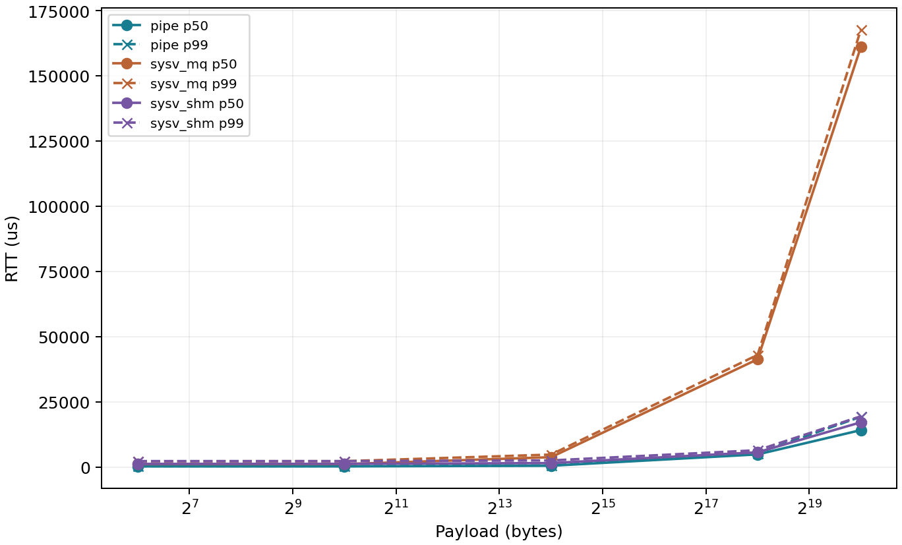
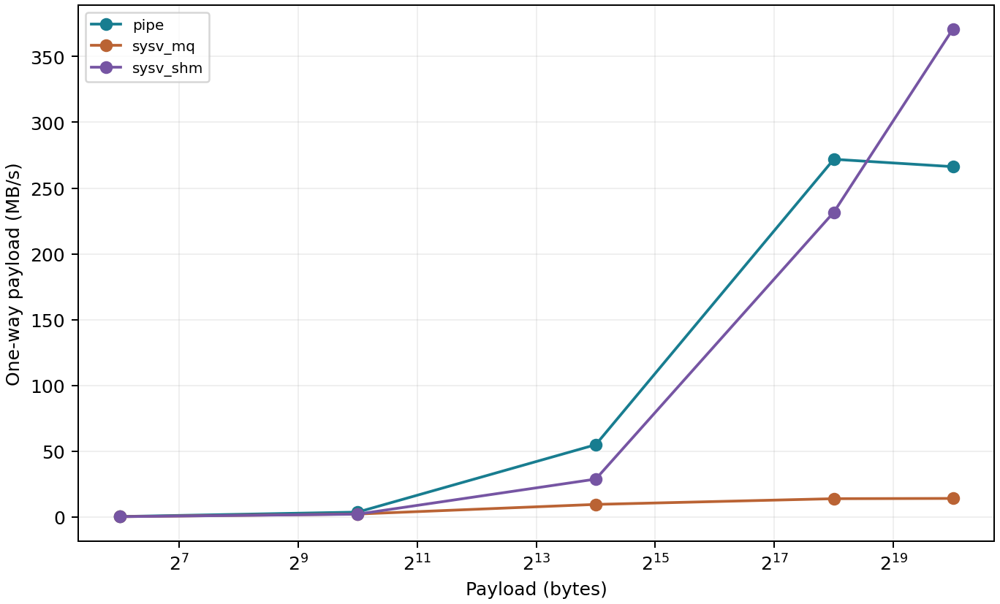

# 1단계 기초 측정 결과 — IPC Filter Farm

2026-11-12에 필터 없는 echo의 필수 IPC 3종 산출물을 검증했다. [예측 원문](ipc-prediction.md)과 실측을 구분한다.

## 측정 조건과 근거

| 항목 | 기록 |
| --- | --- |
| 서버 | `ce22b035@computer.tukorea.ac.kr:22000` |
| 환경 기록 시각 | `environment.txt`의 `recorded_at=2026-11-12T08:31:11Z`(한국 시각 17:31:11). 전체 실행 시작·종료 시각은 이 값으로 추정하지 않는다. |
| OS·컴파일러 | Ubuntu 24.04.5 LTS, Linux `6.8.0-147-generic`, GCC 13.3.0 |
| CPU·메모리 | Xeon Bronze 3106 @ 1.70GHz, 2소켓·16코어, NUMA 2노드, 메모리 약 62.4GiB |
| CPU 설정 | governor `powersave`, affinity `0–15`. 특정 코어에 고정하지 않았다. |
| IPC 제한 | MQ `msgmax=8192`, `msgmnb=16384`; 상세 환경은 첨부 파일에 보존했다. |
| 실험 조합 | IPC 3종 × 페이로드 64B/1KiB/16KiB/256KiB/1MiB × 클라 1/2/4/8 × 지연·처리량 × 3회 = 360회 |
| 고정 조건 | 클라당 워밍업 100회·측정 1,000회, 서버 workers=2, team=1, `--quiet`, `--no-save` |
| 동시 요청 수 | 지연 실험은 클라당 `W=1`, 처리량 실험은 `W=4`다. |

측정·집계 정의는 [기술 구조](03-tech/01-architecture.md#측정과-집계), 실행 절차는 [README](../README.md#기초-측정--예측-작성--응용-측정)를 따른다. RTT에는 전송·대기·echo·수신 검증이 포함된다. MB/s는 응답·헤더를 제외한 단방향 유효 페이로드이며, MB는 1,000,000B다. 아래 값은 실행별 지표의 3회 반복 중앙값이다. 백분위를 전체 반복 샘플에 합쳐 계산한 값은 아니다.

원본은 서버의 `/home/student/cestudent/22/ce22b035/sp-ipc-filter-farm/bench/results/basic-run/`과 `/tmp/ipcff-basic-run.log`에 있다. 원본 디렉터리에는 `basic.csv`, `median.csv`, `environment.txt`, `raw/`, 그래프 13개, 소스 스냅샷과 체크섬이 있다. `/tmp` 로그는 영구 보존을 보장하지 않는다.

이 문서에는 [중앙값 CSV](assets/basic-measurement/median.csv), [실측 환경](assets/basic-measurement/environment.txt), 아래 대표 그래프 2개를 복사해 첨부했다. 전체 원자료 아카이브를 복사한 것은 아니다. CSV에는 전 클라 수의 지연·처리량·CPU·컨텍스트 스위치·RSS가 들어 있다.

2026-11-13(한국 시각)에 원본 디렉터리 전체를 로컬 `bench/results/basic-run/`으로 복사하고 기존 체크섬 8,043개를 확인했다. 파생 CSV·그래프를 포함한 8,059개 파일의 보존 해시는 `bench/results/basic-preservation.SHA256SUMS`에 별도로 기록했다. 첨부 중앙값 CSV는 개행 형식을 제외한 내용이 같고 환경 파일은 바이트가 일치한다. 실측과 구분한 이론 가설은 [IPC 구현·성능 예측](ipc-prediction.md)을 따른다.

측정 소스 `source.tar`의 SHA-256은 다음과 같다. 검증 당시 원격 작업 디렉터리의 스냅샷 대상 파일은 보존된 소스와 일치했다. 실행 바이너리가 이 소스로 빌드됐는지는 별도 빌드 로그 없이 확정하지 않는다.

```text
8b9fbd7ae458897b9dbe2cff3571101f6af91b2a4e4b9344f62b0681d64737cf
```

## 지연 결과

클라 1개·`W=1` 조건이다. 각 칸은 **p50 / p99 RTT(µs)**다.

| 페이로드 | pipe | sysv_mq | sysv_shm |
| --- | ---: | ---: | ---: |
| 64B | 314.641 / 398.653 | 1,156.807 / 2,277.802 | 1,245.627 / 2,324.550 |
| 1KiB | 318.255 / 416.065 | 1,186.481 / 2,295.762 | 1,275.539 / 2,328.759 |
| 16KiB | 554.947 / 683.996 | 3,827.268 / 4,833.331 | 1,568.079 / 2,581.266 |
| 256KiB | 4,899.367 / 5,400.371 | 41,365.718 / 43,033.019 | 5,701.037 / 6,504.121 |
| 1MiB | 14,209.037 / 19,341.608 | 161,094.366 / 167,693.541 | 17,208.916 / 19,511.092 |



pipe의 p50·p99가 전 크기에서 가장 낮았다. MQ·SHM 순위는 1KiB~16KiB 사이에서 바뀌었으며 정확한 역전 크기는 미측정이다.

## 처리량과 클라 수

클라 1개·`W=4` 조건의 단방향 유효 처리량(MB/s)이다.

| 페이로드 | pipe | sysv_mq | sysv_shm |
| --- | ---: | ---: | ---: |
| 64B | 0.223 | 0.140 | 0.135 |
| 1KiB | 3.603 | 2.145 | 2.048 |
| 16KiB | 54.863 | 9.454 | 28.705 |
| 256KiB | 271.897 | 13.809 | 231.642 |
| 1MiB | 266.285 | 14.006 | 370.863 |



MQ·SHM 순위는 1KiB~16KiB, pipe·SHM 순위는 256KiB~1MiB 사이에서 바뀌었다. 1MiB에서는 SHM이 pipe의 약 1.39배이며 정확한 역전 크기는 미측정이다.

1MiB·`W=4`에서 클라 수에 따른 전체 처리량(MB/s)은 다음과 같다.

| IPC | 클라 1 | 클라 2 | 클라 4 | 클라 8 |
| --- | ---: | ---: | ---: | ---: |
| pipe | 266.285 | 300.244 | 317.189 | 319.486 |
| sysv_mq | 14.006 | 13.991 | 15.080 | 14.972 |
| sysv_shm | 370.863 | 372.815 | 373.820 | 375.663 |

이 조건에서 `sysv_shm`은 클라 1개에서도 높은 처리량을 보였지만 클라 8개까지 늘렸을 때 증가는 약 1.3%였다. `pipe`의 증가는 약 20.0%였고, `sysv_mq`는 약 14–15MB/s 범위에 머물렀다. 클라 수에 비례한 확장은 관찰되지 않았다.

## 자원 사용

클라 1개·1MiB·`W=4`에서 서버와 클라 자원의 합계 중앙값이다. CPU는 측정 1,000건 구간의 누적 시간이며 사용률이 아니다. RSS는 경계 시점의 합계이며 최대 메모리가 아니다. 공유 페이지가 중복 계산될 수 있다.

| IPC | user CPU(ms) | sys CPU(ms) | 자발적 / 비자발적 전환 | 시작 / 종료 RSS(KiB) |
| --- | ---: | ---: | ---: | ---: |
| pipe | 8,426.595 | 4,302.932 | 9,565 / 35 | 10,884 / 10,000 |
| sysv_mq | 21,178.953 | 10,767.165 | 251,365 / 112 | 12,984 / 14,252 |
| sysv_shm | 8,758.278 | 145.879 | 5,537 / 21 | 25,316 / 23,524 |

이 조건에서 `sysv_mq`는 CPU 시간과 자발적 컨텍스트 스위치가 가장 컸다. `sysv_shm`은 sys CPU 시간이 낮았고 RSS 합계는 가장 컸다.

## 결과가 나온 이유

분석한 IPC·공통 대기·서버·클라·체크섬 코드 9개는 측정 소스와 해시가 일치했다. 아래는 코드와 관찰이 부합하는 해석이며, 요인별 기여율은 미측정이다.

| 경로 | 구현과 해석 |
| --- | --- |
| 작은 데이터 | MQ·SHM은 비차단 실패 후 [ipc_nap](../src/ipc/ipc_util.h)으로 1ms 재시도한다. 1ms대 p50·2ms대 p99와 부합하지만 sleep 횟수·인과는 미확인이다. [pipe](../src/ipc/ipc_pipe.c)의 poll 100ms는 준비되면 반환하는 최대 대기다. |
| 대형 MQ | [청크](../src/ipc/ipc_sysv_mq.h)는 최대 8,000B이고 큐 점유는 최대 8,020B다. 16,384B 큐에는 최대 청크 2개만 들어가므로 분할·검증·재조립·할당·재시도 비용이 증가할 수 있다. |
| 대형 SHM | [공용 링](../src/ipc/shm_ring.c)은 메시지를 청크로 나누지 않아 토큰 제어 횟수가 크기에 비례하지 않는다. 왕복 페이로드 복사 4회와 SEM은 남는다. 높은 처리량·낮은 sys CPU와 부합하지만 예약 링 용량을 RSS 증가량으로 볼 수는 없다. |
| W=1과 W=4 | W=4는 전달·서버 처리·응답을 겹칠 수 있다. 따라서 W=1 지연 순위와 처리량 순위가 달라도 모순이 아니며 p50 역수로 W=4 처리량을 구하지 않는다. |
| 클라 확장 | [서버](../src/server.c)의 receiver·responder 각 1개와 worker 2개는 늘지 않는다. [체크섬](../src/common/proto.c) 전 바이트 순회 3회와 작업 큐도 공통 비용이다. 포화와 부합하지만 특정 스레드·메모리 대역폭을 병목으로 확정하지 않는다. |

MQ의 코드상 성공 호출 수는 다음과 같다. 재시도·상대 확인·종료 통보를 제외한 계산이며 실제 계측값은 아니다.

| 페이로드 | 편도 청크 수 `ceil((B+48)/8000)` | 왕복 정상 전달에 필요한 성공 MQ 호출 수 |
| --- | ---: | ---: |
| 64B / 1KiB | 1 | 4 |
| 16KiB | 3 | 12 |
| 256KiB | 33 | 132 |
| 1MiB | 132 | 528 |

## 해석의 한계와 원인 확인 조건

반복 간 변동도 있다. `pipe` 16KiB·클라 4·`W=4`의 p99는 758.332–1,439.243µs로 최대/최소가 약 1.90배였다. 당시 다른 사용자 부하·실제 CPU 주파수·NUMA 배치의 연속 기록이 없어 변동 원인은 미확인이다. 원인을 구분하려면 동일 조건의 반복 및 단일 요인 실험이 필요하다. 이 결과는 해당 서버와 구현의 비용을 나타내며 IPC 일반의 절대 우열이나 필터 응용의 순위를 확정하지 않는다.

다음은 기초 벤치 조건에서 아직 실행하지 않은 확인이다. 응용 조건의 큐 용량 실험은 [별도 S5 비교](app-measurement.md#s5-mq-큐-용량)에서 확인했으며 기초 벤치의 원인 실험과 구분한다. 기초 원자료만으로 요인별 비용을 분리할 수 없어 대기하며, 해당 조건의 진단·실험 결과가 생기면 설명을 확정하거나 수정한다. 진단 실행은 정식 성능 표에 섞지 않는다.

| 원인 후보 | 확인할 실험·증거 |
| --- | --- |
| SysV의 1ms 재시도 영향 | 별도 진단에서 sleep·실패 호출 횟수와 대기 시간을 기록하고, 재시도 간격만 바꿔 동일 조건의 RTT·처리량·CPU를 비교한다. |
| 기초 벤치의 MQ 큐 용량 영향 | 응용 S5와 구분해 기초 echo 조건에서 청크 크기·나머지 조건을 유지하고 큐 용량만 바꾼다. 실제 `msg_qbytes`를 확인하고 측정 후 원복한다. |
| 대형 메시지의 공통 병목 | receiver·worker·responder별 CPU·대기 시간과 체크섬 비용을 별도로 계측한다. 정식 비교의 수신 체크섬 검증은 유지한다. |
| 반복 변동의 영향 | 부하·주파수·CPU/NUMA 배치를 기록하며 같은 조건을 반복한다. 이후 affinity 등 한 조건만 바꾸어 비교한다. |

## 검증 판정과 남은 확인

| 확인 항목 | 판정 |
| --- | --- |
| 실행 로그·조합 | 완료 기록 360개와 기대 조합이 일치하며 누락·중복이 없다. 비어 있지 않은 stderr가 없다. |
| 원시 샘플 | 측정 135만 건의 client ID·seq·페이로드·양수 RTT를 검사했다. 각 클라는 측정 seq 100–1099를 정확히 한 번씩 기록했다. |
| 응답·체크섬 오류 | 클라 로그 1,350개가 모두 `matched=1000 mismatches=0 warmup=100`이며, 서버 로그 360개의 응답 수가 기대값과 일치한다. |
| 실행별 집계 | 원시 RTT와 자원 sidecar에서 재계산한 평균·p50/p95/p99/max·처리량·CPU·전환·RSS가 `basic.csv`와 일치한다. |
| 반복 집계·그래프 | 중앙값 120행이 재계산과 일치한다. 임시 경로에서 재생성한 `median.csv`는 바이트가, 그래프 13개는 픽셀이 원본과 일치한다. 대표 그래프의 축·범례도 확인했다. |
| 파일 무결성 | `sha256sum -c SHA256SUMS`의 8,043개 항목(원자료 파일 8,040개 포함)과 `source.sha256`이 통과했다. |
| 종료 후 IPC | 실행별 `ipcs-after.txt` 360개에 MQ·SHM·SEM 잔존 항목이 없다. |

기존 `SHA256SUMS`에는 `median.csv`와 그래프가 포함되지 않는다. 산출물 검증은 재계산·재생성으로 이 파일들을 별도로 확인했으며, 원격 체크섬 목록은 수정하지 않았다. 로컬 보존본은 위의 별도 해시 목록으로 파생 파일까지 고정했다. 원격 `/tmp` 실행 로그는 이 디렉터리 복사에 포함되지 않는다.

전체 코드의 검증 판정은 [테스트 명세](04-test/01-verification.md#현재-검증-판정)를 따른다.
