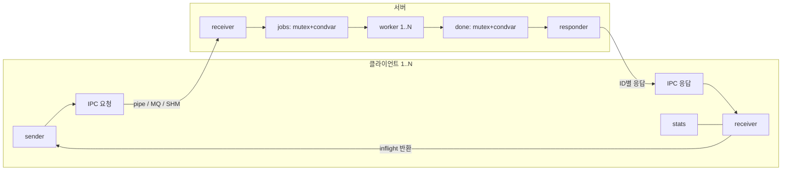

# UNIX시스템프로그래밍 설계과제 최종보고서 초안

설계과제 명: IPC Filter Farm · 팀 번호: 1 · 작성일: 2026-11-04

**제출 전 초안이다. 기초·응용 실측과 개선 비교, Linux 빌드·단위·응용 통합·장애·정리 검사를 확인했다. S5 큐 확대·공정성 추적·발표 녹화와 팀원 정보는 미확정 상태다.** 상세 판정은 [검증 명세](04-test/01-verification.md#현재-검증-판정), 원문 양식은 [최종보고서 서식](final-report-template.md), 실행·측정 명령은 [README](../README.md)를 따른다.

| 학번 | 성명 | 역할 | 담당 IPC 버전 |
| --- | --- | --- | --- |
| 미제공 | 미제공 | 미확인 | 미확인 |
| 미제공 | 미제공 | 미확인 | 미확인 |
| 미제공 | 미제공 | 미확인 | 미확인 |

## 1. 문제 정의 및 요구사항 분석

- **1.1 목표:** 다수 클라이언트의 RGB 이미지를 서버가 GRAY·BLUR·EDGE로 변환하며, 필수 3종 IPC(`pipe`, `sysv_mq`, `sysv_shm`+SEM)의 지연·처리량·자원 사용을 비교·개선한다.
- **1.2 요구사항:** 기능·정합성·완료 기준은 [요구사항](01-func/01-requirements.md#범위)과 [완료 기준](01-func/01-requirements.md#완료-기준)을 따른다.

## 2. IPC 기초 성능 측정 (1단계)

- **2.1 측정 환경:** 실제 환경과 원자료 위치는 [기초 측정 결과](basic-measurement.md#측정-조건과-근거)에 기록했다.
- **2.2 벤치마크 설계:** `basic_server/basic_client`는 필터만 생략한 공용 echo 빌드다([실행 인터페이스](01-func/01-requirements.md#실행-인터페이스), [벤치 설계](03-tech/01-architecture.md#벤치-설계)).
- **2.3~2.4 결과 및 해석:** 실측 표·그래프·자원 사용과 해석의 한계는 [기초 측정 결과](basic-measurement.md)에 통합했다. 실측과 구분한 이론 가설은 [IPC 구현·성능 예측](ipc-prediction.md)으로 관리한다.

## 3. 워크로드 명세와 성능 예측

- **3.1 워크로드:** 정량 조건은 [워크로드와 예측](01-func/01-requirements.md#워크로드와-예측)을 따른다. `jobs`(`receiver→worker`)와 `done`(`worker→responder`)은 작업마다 mutex 잠금/해제 1쌍과 condvar 신호 1회를 수행한다.
- **3.2 성능 예측:** [IPC 구현·성능 예측](ipc-prediction.md)에 구현 전 예측 원문과 2026-11-13의 구현 후·응용 정식 측정 전 보완을 구분했다. 작성 여부의 확인 근거는 해당 문서에 기록했다. 원문 보존과 수정 내용·이유의 구분은 [예측 기록](03-tech/01-architecture.md#예측-기록)을 따른다.

## 4. 시스템 설계

### 4.1 소프트웨어 설계도

### 4.2 스레드 및 동기화 설계

| 프로세스 | 스레드 | 함수·역할 | 동기화·공유 자원 |
| --- | --- | --- | --- |
| 서버 | `receiver` | `receive_requests`: 요청 검증·`jobs` 게시 | `permits` 세마포어, `jobs` mutex/condvar |
| 서버 | `worker × N` | `work`: 필터/echo 처리·`done` 게시 | `jobs`/`done` 소유권 이전 |
| 서버 | `responder` | `respond`: ID 라우팅·워밍업 barrier·CPU 경계 | `done` 소비, 송신 mutex |
| 클라 | `sender` | `send_requests`: `inflight` 획득·시각 기록·전송 | `inflight` 세마포어, `sent` mutex/condvar |
| 클라 | `receiver` | `receive_responses`: 체크섬/seq 검증·RTT 누적 | `sent/rtt` mutex, `inflight` 반환 |
| 클라 | `stats` | `report_progress`: 진행 집계(벤치 시 출력 억제) | `completed` mutex, atomic `g_stop` |

상세 레이아웃과 수명 관리는 [아키텍처](03-tech/01-architecture.md#아키텍처와-경계)와 [IPC 프로토콜](03-tech/03-protocol.md#데이터와-정합성)을 따른다.

## 5. 시스템 구현 및 데모

- **5.1 구현 요약:** 백엔드별 생성·송수신·해제 API와 파일 위치는 [IPC 목록](03-tech/02-ipc-inventory.md)을 따른다.
- **5.2~5.3 데모 및 결과:** `bench/demo.sh`로 ID1 GRAY·ID2 EDGE 동시 처리와 전후 `ipcs`를 수집한다. 구버전 [Linux 로그](../tests/logs/linux-simplification.log)는 현 버전의 증거로 쓰지 않으며, 새 Linux 캡처가 필요하다.

## 6. 성능 측정과 분석

- **6.1~6.2 제약 반영 및 방법:** 스레드·동기화·개별 빌드와 `--inplace-gray` 개선 옵션을 구현했으며, [측정과 집계](03-tech/01-architecture.md#측정과-집계) 규칙에 따라 CPU/RSS 경계와 RTT·처리량을 수집한다.
- **6.3~6.6 결과·비교·개선·가이드라인:** S1~S5 기본 용량 실측·예측 대조·`--inplace-gray` 전후 비교와조건별 IPC 선택 근거는 [응용 측정과 개선 비교](app-measurement.md)에 통합했다. 버퍼 재사용은 종료 RSS 중앙값을 줄였으나 처리량 향상은 관찰하지 못했다. S5 확대 효과는 미검증이다.

## 7~9. 팀워크·결론·부록

- **7. 팀워크:** 팀원 학번·성명·담당 IPC·실제 기여 확인 필요.
- **8. 결론 및 AI 활용:** 검증 상태는 [현재 판정](04-test/01-verification.md#현재-검증-판정), AI 코드 오류 2건의 검출·수정은 [AI 기록](ai-record.md)을 따른다(대화 캡처 추가 필요).
- **9. 부록:** 제출 tar 구성과 남은 절차는 [README](../README.md#데모진단제출-패키지)와 [남은 작업](03-tech/01-architecture.md#남은-작업과-리스크)을 따른다(초안 PPT는 [발표자료 초안](../submission/presentation-draft.pptx)).
