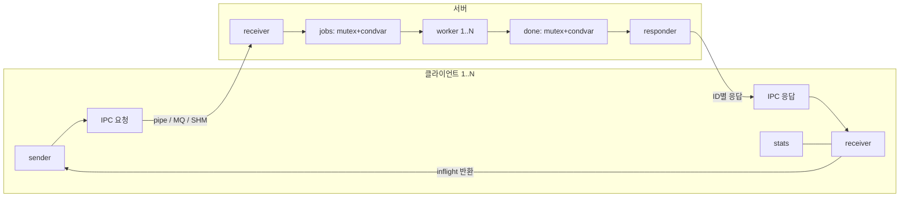

# UNIX시스템프로그래밍 설계과제 최종보고서 초안

설계과제 명: IPC Filter Farm · 팀 번호: 1 · 작성일: 2026-11-04

제출 전 초안이다. 본문 근거는 아래 원본 문서에서 관리하며, 최종 제출은 [서식](final-report-template.md)을 따른다. [현재 검증 판정](04-test/01-verification.md#현재-검증-판정)과 [남은 작업](03-tech/01-architecture.md#남은-작업과-리스크)을 확인한다.

| 학번 | 성명 | 역할 | 담당 IPC 버전 |
| --- | --- | --- | --- |
| 미제공 | 미제공 | 미확인 | 미확인 |
| 미제공 | 미제공 | 미확인 | 미확인 |
| 미제공 | 미제공 | 미확인 | 미확인 |

## 1. 문제 정의 및 요구사항 분석

프로젝트의 목적·범위·완료 기준은 [요구사항](01-func/01-requirements.md)을 따른다.

## 2. IPC 기초 성능 측정 (1단계)

환경·설계·실측·그래프·해석 한계는 [기초 측정 결과](basic-measurement.md)에 기록한다.

## 3. 워크로드 명세와 성능 예측

[정량 워크로드](01-func/01-requirements.md#워크로드와-예측)와 [예측 원문·구현 후 보완](ipc-prediction.md)을 구분한다. 작성 시점은 소급하지 않는다.

## 4. 시스템 설계

[아키텍처·스레드·동기화](03-tech/01-architecture.md#아키텍처와-경계)와 [메시지 계약](03-tech/03-protocol.md)을 따른다.

## 5. 시스템 구현 및 데모

[IPC별 구현](03-tech/02-ipc-inventory.md)과 [전후 이미지·시스템 콜·공정성 분석](diagnostics-measurement.md)을 근거로 사용한다.

## 6. 성능 측정과 분석

[S1~S5·개선 비교·예측 대조·IPC 선택](app-measurement.md)에 수치와 적용 범위를 기록한다.

## 7~9. 팀워크·결론·부록

팀원·담당·기여는 미제공이므로 확인 후 작성한다. [AI 오류 검증 2건](ai-record.md)의 대화 캡처와 최종 발표·영상이 필요하다. [실행·패키징](../README.md#데모진단제출-패키지)과 [PPT 초안](../submission/presentation-draft.pptx)을 참고한다.
