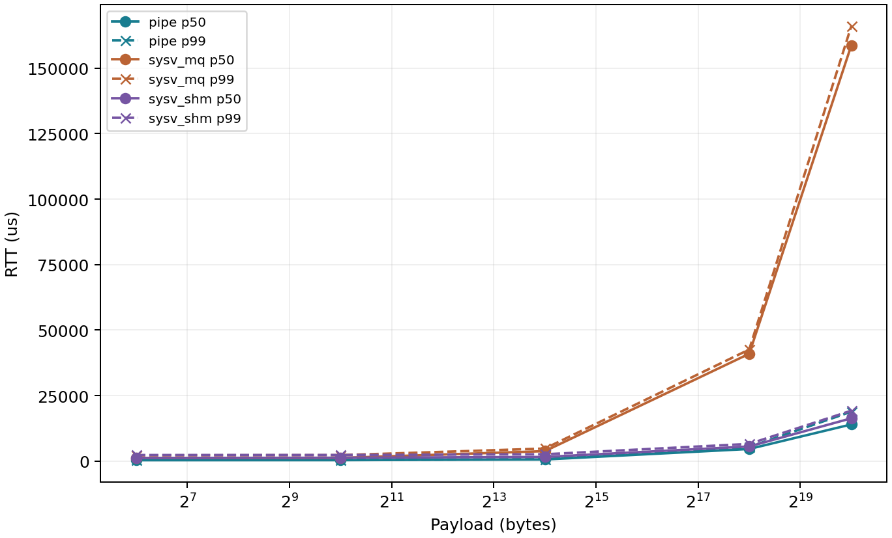
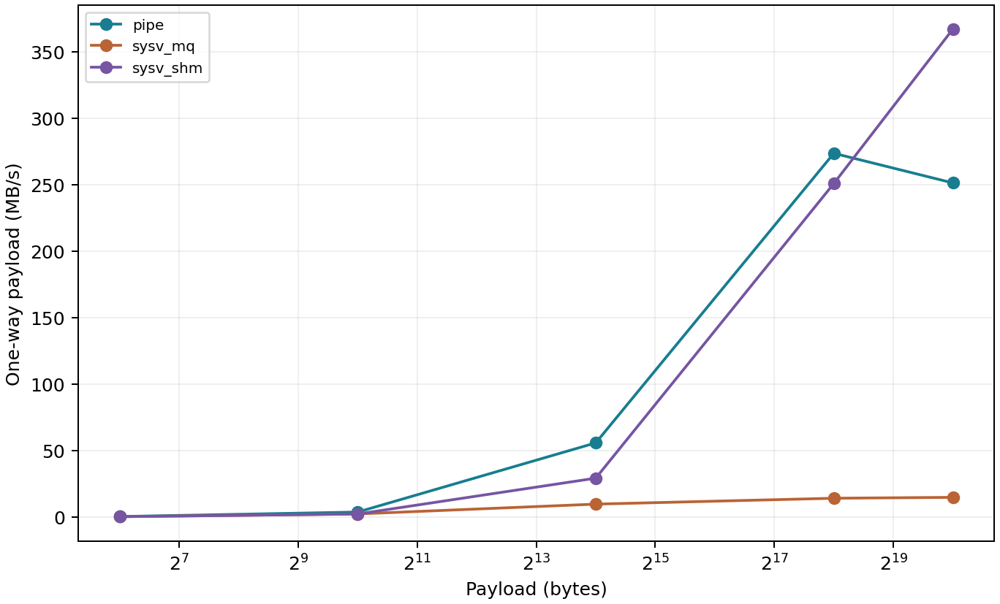
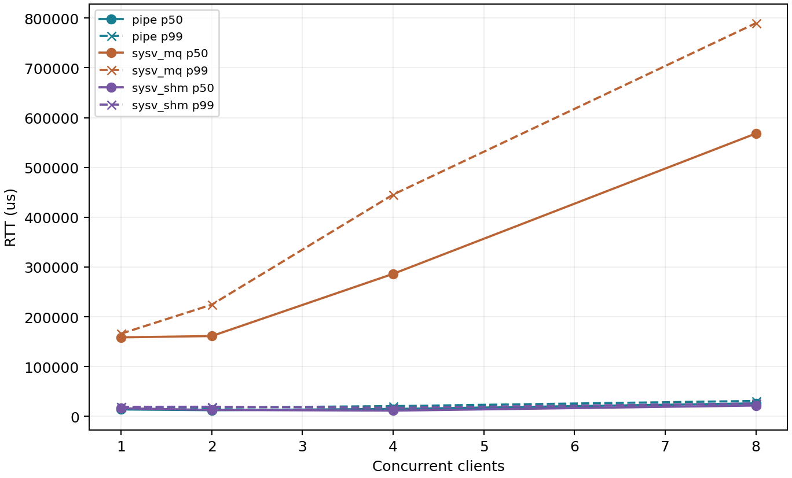
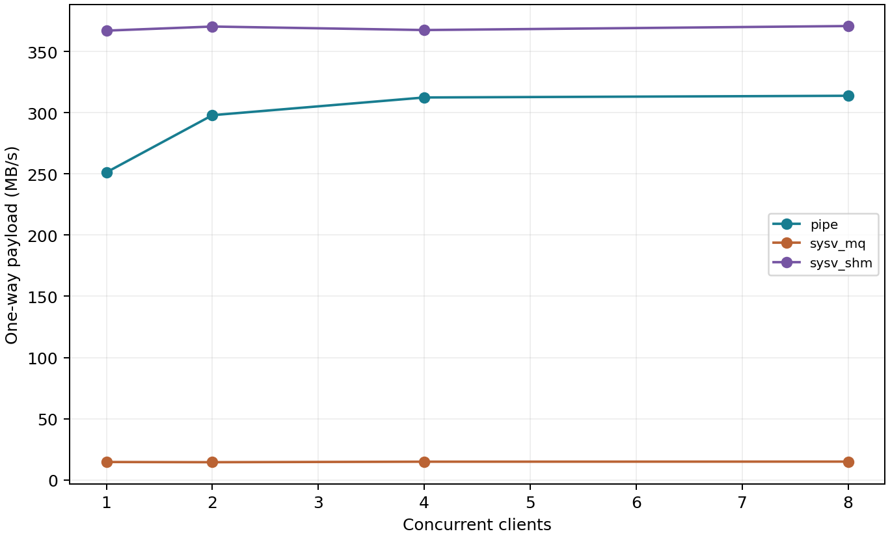
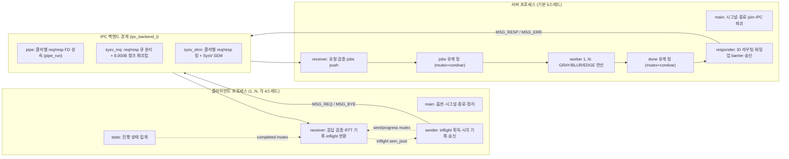
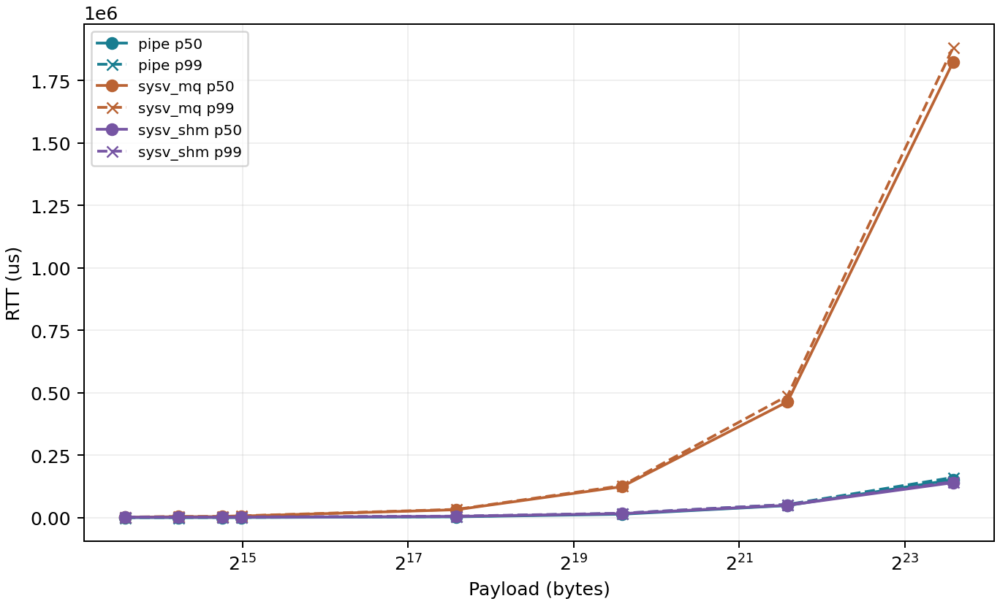
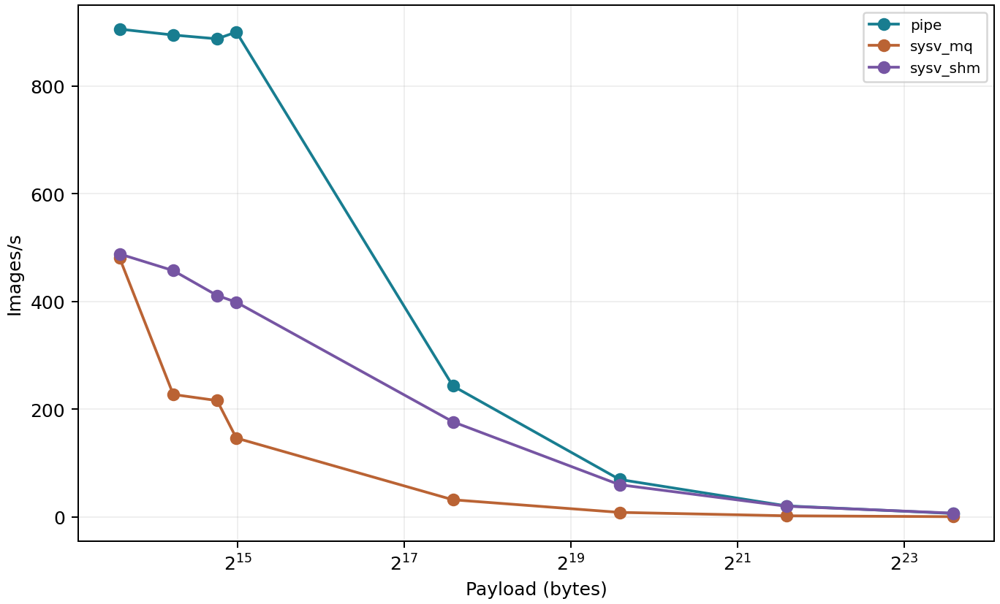
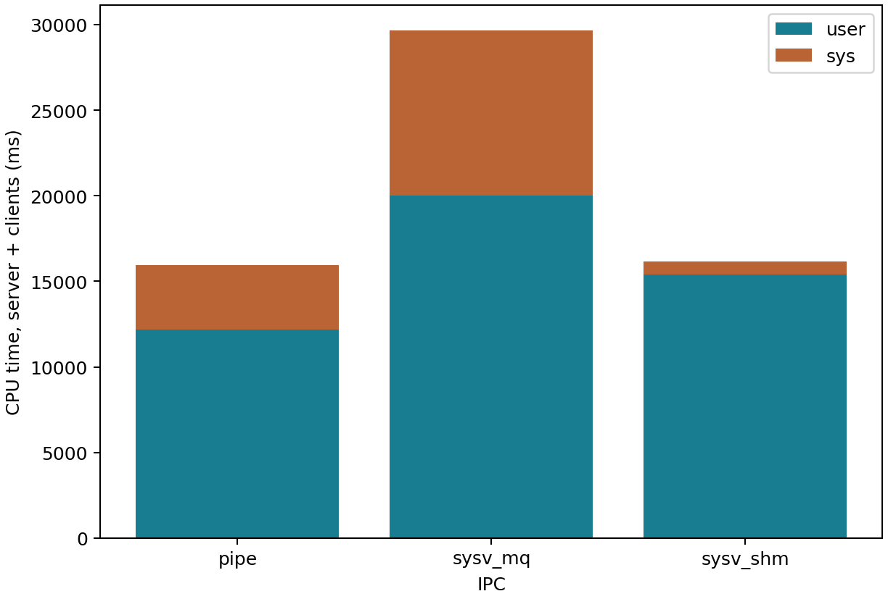
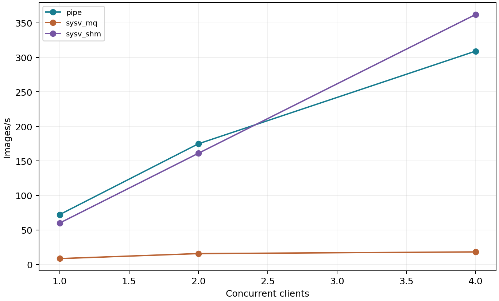
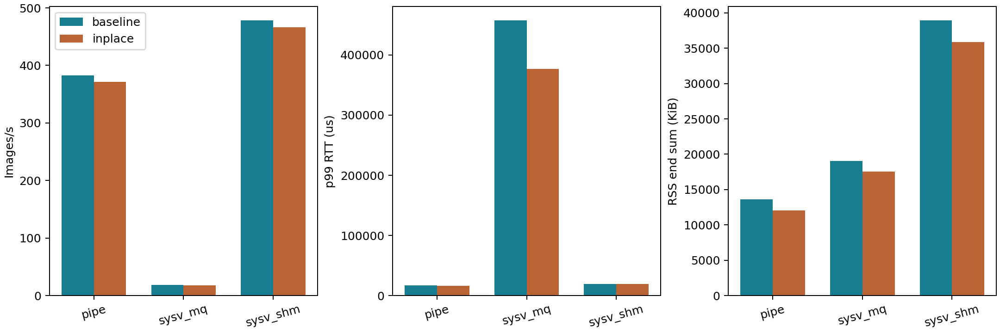

# UNIX시스템프로그래밍 설계과제 최종보고서

> **작성 안내:** 본 문서는 [최종보고서 서식](../docs/final-report-template.md)의 목차와 항목 순서를 그대로 따라 작성한 제출용 보고서 본문이다. 1단계 기초(360회)·2단계 응용(156회)·설계 개선(18회) 수치는 2026-11-19~20 Ubuntu Linux 서버의 클린 빌드(`build.log`·`binaries.sha256` 보존) 정식 재측정 원자료에서, 별도 S5 큐 확대 비교(3쌍)와 데모·`strace`·R3 진단은 2026-11-13 검증 원자료에서 직접 인용했다. `[기입 필요]`로 표시된 팀원 정보·제출 날짜·AI 대화 부록만 채운 뒤 PDF로 변환해 제출한다.

## 보고서 표지

- **제목:** UNIX시스템프로그래밍 설계과제 최종보고서
- **설계과제 명:** IPC Filter Farm — 멀티클라이언트 이미지 필터 처리 서버의 IPC 예측·구현·검증·개선
- **제출 날짜:** 2026년 [기입 필요]월 [기입 필요]일
- **팀명 / 팀 번호:** [기입 필요: 팀명] / 1팀 (`--team=1`, SysV key `60010`~`60013`, POSIX 이름 `/osproject_1_shm`)
- **팀원:**

| 학번 | 성명 | 역할 | 담당 IPC 버전 |
| --- | --- | --- | --- |
| [기입 필요] | [기입 필요] | 팀장 | [기입 필요: pipe / sysv_mq / sysv_shm] |
| [기입 필요] | [기입 필요] | 팀원 | [기입 필요: pipe / sysv_mq / sysv_shm] |
| [기입 필요] | [기입 필요] | 팀원 | [기입 필요: pipe / sysv_mq / sysv_shm] |

---

## 1. 문제 정의 및 요구사항 분석

### 1.1 문제 정의 및 설계과제 목표

**IPC Filter Farm**은 여러 클라이언트가 동시에 요청하는 RGB(PPM P6, 3채널) 이미지에 서버가 `GRAY`(흑백), `BLUR`(3×3 평균), `EDGE`(Sobel 경계 검출) 필터를 적용해 반환하는 로컬 클라이언트-서버 병렬 처리 응용이다. 단순 메시지 중계가 아니라, 서버 내부의 다중 워커 스레드가 공유 작업 큐(`jobs`/`done`)를 통해 픽셀 연산을 수행하고 결과를 요청 클라이언트에게 정확히 라우팅한다.

이 응용에서 IPC 선택이 성능에 중요한 이유는 다음과 같다.

- **넓은 페이로드 스펙트럼:** 이미지 한 변이 64px에서 2048px까지 변하면 편도 페이로드가 `12KiB`에서 `12MiB`까지 약 1,024배 증가한다. 작은 이미지에서는 시스템 콜·동기화 대기 같은 고정 비용이, 큰 이미지에서는 커널-사용자 공간 복사·청크 분할·메모리 대역폭 비용이 지배적으로 작용한다.
- **동시 요청과 파이프라인 경합:** 다수 클라이언트(`N=1..4`)와 파이프라인 깊이(`W=1..16`)가 늘어나면 통신 채널의 버퍼 용량과 동기화 방식이 처리량과 꼬리 지연(`p99 RTT`)을 크게 바꾼다.
- **연산 대 통신 비중 변화:** 연산량이 가벼운 `GRAY`에서는 IPC 비용이 병목으로 드러나고, 무거운 `BLUR`/`EDGE`에서는 필터 연산이 통신 차이를 희석한다.

따라서 본 과제의 목표는 **익명 `pipe`**, **System V Message Queue(`sysv_mq`)**, **System V Shared Memory + Semaphore(`sysv_shm`)** 3종(선택 확장으로 `fifo`, `posix_shm` 추가 구현)에 대해 1단계 기초 성능을 측정하고, 이를 바탕으로 2단계 응용 성능을 구현 전 예측·실측 비교·단일 요인 원인 실험·설계 개선까지 수행해 근거 있는 IPC 선택 기준을 도출하는 것이다.

### 1.2 요구사항 분석

#### 기능 요구사항
- **서버(`server`, `basic_server`):** 지정한 IPC 채널로 다수 클라이언트의 요청을 수신해 헤더·페이로드 길이·FNV-1a 32bit 체크섬을 검증한다. 정상 요청은 유계 작업 큐(`jobs`)를 통해 다중 워커에 분배해 필터(1단계 기초 벤치는 echo)를 수행하고, 완료 큐(`done`)를 거쳐 요청 `client_id`로 응답한다. 모든 클라이언트의 `MSG_BYE` 수신 또는 `SIGINT` 시 유한 시간 안에 종료하고 IPC 자원을 해제한다.
- **클라이언트(`client`, `basic_client`):** 합성 PPM P6 이미지를 생성해 메모리에 적재한 뒤, 최대 `W`개의 미완료 요청(`inflight`)을 파이프라인으로 송신한다. 응답의 `client_id`, `seq`, `t_send_ns`, 체크섬을 전건 검증하고 RTT·자원 사용량을 CSV로 기록한다. 데모 모드에서는 입력·결과 PPM 이미지 1쌍을 저장하고, 벤치마크 모드에서는 `--no-save`로 파일 I/O를 제외한다.
- **익명 파이프 실행기(`pipe_run`):** 익명 파이프는 부모의 FD 상속이 필요하므로, 클라이언트 수만큼 요청·응답 파이프를 생성해 서버와 클라이언트를 `fork/exec`하고 로그·CSV·종료 회수를 관리한다.
- **자원 정리 도구(`clean_ipc`, `basic_clean_ipc`):** 비정상 종료 시 잠금 소실과 소유 기록(생성 식별자·UID·inode)을 확인한 뒤 본인 자원만 안전하게 회수한다.

#### 정량 비기능 요구사항
- **정합성:** 2클라이언트 × 1,000장(`512²`, `depth=4`/`16`) 비순차 `seq` 처리에서 유실·중복·체크섬 오류·클라이언트 간 혼입 **0건**을 달성한다.
- **주 지표와 보조 지표:** 응용의 주 지표는 처리량(`images/s`)이며, 보조 지표는 지연시간(`mean`, `p50`, `p95`, `p99`, `max` RTT)과 자원 사용량(`ru_utime`, `ru_stime`, `nvcsw`, `nivcsw`, 시작/종료 `VmRSS`)이다.
- **측정 공정성(R1~R7):**
  - `R1`: 전 백엔드 동일 48B `msg_hdr_t` 사용(1단계는 지정 바이트 전송 + 제어 비용 별도 명시).
  - `R2`: 모든 수신 경로에서 FNV-1a 32bit 체크섬 계산·대조.
  - `R3`: 측정 중 이미지·결과·CSV 파일 I/O 및 진행 출력을 제외하며, 제어 메타데이터 접근과 런타임 `/proc` 조회는 구현 비용에 포함해 추적으로 공개(2026-11-13 측정 후 정정, 소급하지 않음).
  - `R4`: `--no-save` 지원 및 벤치마크 필수 적용.
  - `R5`: 시간 측정은 `CLOCK_MONOTONIC` 사용(`CLOCK_REALTIME`은 `sem_timedwait` deadline 전용).
  - `R6`: 평균·p50·p95·p99·max 동시 보고.
  - `R7`: 응용 코드 내 백엔드별 분기 금지(백엔드 테이블은 `src/ipc/ipc.c`에만 한정).

#### 제약 조건 충족
- **스레드 수:** 서버 기본 5개(`main`, `receiver`, `worker` 2개, `responder`), 클라이언트 4개(`main`, `sender`, `receiver`, `stats`)로 양측 모두 최소 3스레드 조건을 충족한다.
- **동시 클라이언트:** 1단계 기초 벤치 1~8개, 2단계 이미지 응용 1~4개 동시 실행을 지원한다.
- **표준 도구·빌드:** C11/POSIX(`libc`, `pthread`, `rt`)와 `Makefile`을 사용하며, `make` 전체 빌드와 `make phase1-<ipc>` / `make phase2-<ipc>` 개별 빌드를 경고 0(`-Wall -Wextra -Werror`)으로 통과한다.
- **IPC 키와 자원 정리:** 1팀 기준 SysV key `60010`~`60013`(`60000 + 10×team + 용도`), POSIX 이름 `/osproject_1_shm`을 사용하며, 종료 시 생성한 모든 IPC 자원을 해제하고 `ipcs -q -m -s`로 잔존 0건을 확인한다.

---

## 2. IPC 기초 성능 측정 (1단계)

### 2.1 측정 환경

정식 재측정(2026-11-19~20: 1단계 기초·2단계 응용·설계 개선)과 별도 S5 확대·데모 진단(2026-11-13)은 모두 동일한 팀 공통 Linux 서버(`computer.tukorea.ac.kr:22000`)에서 수행했다.

| 항목 | 내용 |
| --- | --- |
| CPU 모델 / 코어 수 | Intel Xeon Bronze 3106 @ 1.70GHz, 2소켓 × 8코어 × 1스레드(총 16코어, NUMA 2노드) |
| 메모리 | 총 62.4GiB (가용 약 53GiB, Swap 2.0GiB) |
| OS 배포판 / 커널 버전 | Ubuntu 24.04.5 LTS / Linux `6.8.0-149-generic` (`x86_64`, 11-13 별도 S5·데모는 `6.8.0-147-generic`) |
| gcc 버전 | GCC 13.3.0 (`-std=c11 -D_POSIX_C_SOURCE=200809L -Wall -Wextra -Werror -O2`) |
| 가상화 여부 | 없음 (네이티브 베어메탈, `systemd-detect-virt`: `none`) |
| CPU·IPC 시스템 설정 | governor `powersave`, affinity `0–15`(미고정), SysV MQ `msgmax=8192` B, `msgmnb=16384` B |
| 빌드·소스 대응 증명 | 측정 직전 클린 빌드 로그(`build.log`), 바이너리 9종 해시(`binaries.sha256`), `source.tar` SHA-256(`18ecd19b...`) 보존 |

### 2.2 벤치마크 설계

- **구조:** 2단계 응용과 동일한 IPC 백엔드·스레드 파이프라인·체크섬 검증 경로를 재사용하되, `-DBASIC_BENCH=1 -DSLOT_COUNT=8`로 빌드한 `basic_server`·`basic_client`로 필터 연산 없이 바이트를 그대로 echo한다.
- **실험 조합:** 필수 IPC 3종(`pipe`, `sysv_mq`, `sysv_shm`) × 페이로드 5단계(`64B`, `1KiB`, `16KiB`, `256KiB`, `1MiB`) × 클라이언트 수 4단계(`1`, `2`, `4`, `8`) × 측정 모드 2종(지연 `W=1`, 처리량 `W=4`) × 독립 3반복 = **총 360회 실행, 측정 표본 1,350,000건**.
- **워밍업과 반복:** 매 실행마다 클라이언트당 워밍업 100회(`seq=0..99`)를 먼저 마친 뒤 측정 1,000회(`seq=100..1099`)를 기록한다. 각 지표는 실행 내 전 클라 표본에서 산출한 뒤 3반복의 중앙값을 보고한다.
- **타임스탬프 위치와 이유:**
  - `t_send_ns`: `client`의 `sender` 스레드가 `inflight` 세마포어를 획득한 뒤 `backend->send()` 호출 직전에 `clock_gettime(CLOCK_MONOTONIC)`으로 기록한다.
  - `finished`: `client`의 `receiver` 스레드가 `backend->recv()`로 응답을 받고 체크섬·`seq`·`t_send_ns` 검증을 마친 직후 기록한다.
  - 이 경계를 택한 이유는 송신 대기·커널/링 전달·서버 큐/응답·수신 체크섬 검증까지 응용이 실제로 체감하는 종단 간 왕복 비용을 빠짐없이 포함하기 위함이다.
- **자원 계측 경계:** 서버는 전 클라이언트의 마지막 워밍업 응답을 보류했다가 모두 준비되면 시작 `VmRSS` → `getrusage()` 순서로 기록한 뒤 일괄 송신하고, 마지막 측정 응답 송신 직후 `getrusage()` → 종료 `VmRSS`를 기록한다. 클라이언트도 워밍업 전건 수신 직후와 마지막 측정 검증 직후 같은 순서로 기록한다. 따라서 `VmRSS` 파일 읽기는 `getrusage()` CPU 구간 바깥에 위치한다.
- **제어 비용:** 지정 데이터 `B`바이트 외 편도 48B 헤더(`msg_hdr_t`)와 MQ 청크별 20B·`mtype` 비용이 별도로 발생하며, 단방향 유효 처리량(`MB/s`, `1MB = 1,000,000B`)은 순수 데이터 바이트만 집계한다.

### 2.3 측정 결과

#### 메시지 크기별 왕복 지연시간 (클라이언트 1, `W=1`, 3회 중앙값, 단위: µs)

| 페이로드 | pipe (mean / p50 / p99 / max) | sysv_mq (mean / p50 / p99 / max) | sysv_shm (mean / p50 / p99 / max) |
| --- | ---: | ---: | ---: |
| 64B | 282.661 / 303.296 / 380.057 / 394.247 | 1,242.037 / 1,174.332 / 2,166.148 / 2,373.912 | 1,244.533 / 1,164.091 / 2,280.078 / 2,423.868 |
| 1KiB | 314.832 / 322.466 / 408.780 / 428.752 | 1,213.489 / 1,187.107 / 2,242.832 / 2,415.248 | 1,301.995 / 1,248.227 / 2,294.165 / 2,484.215 |
| 16KiB | 581.634 / 583.969 / 703.218 / 928.436 | 3,736.062 / 3,763.540 / 4,765.490 / 4,939.111 | 1,545.049 / 1,553.220 / 2,576.401 / 2,709.686 |
| 256KiB | 4,540.037 / 4,595.648 / 5,366.708 / 6,499.418 | 39,751.489 / 40,951.017 / 42,576.069 / 43,656.496 | 5,560.101 / 5,553.057 / 6,535.529 / 7,530.856 |
| 1MiB | 13,995.594 / 13,970.996 / 18,834.861 / 19,763.128 | 154,384.909 / 158,764.067 / 166,129.170 / 167,092.634 | 16,298.031 / 16,314.567 / 19,227.956 / 24,113.677 |



#### 메시지 크기별 단방향 유효 처리량 (클라이언트 1, `W=4`, 3회 중앙값)

| 페이로드 | pipe (MB/s · msg/s) | sysv_mq (MB/s · msg/s) | sysv_shm (MB/s · msg/s) |
| --- | ---: | ---: | ---: |
| 64B | 0.229 · 3,576.2 | 0.142 · 2,217.8 | 0.139 · 2,179.2 |
| 1KiB | 3.606 · 3,521.6 | 2.210 · 2,157.8 | 2.140 · 2,090.3 |
| 16KiB | 55.657 · 3,397.0 | 9.578 · 584.6 | 29.110 · 1,776.8 |
| 256KiB | 273.574 · 1,043.6 | 14.009 · 53.4 | 250.839 · 956.9 |
| 1MiB | 251.279 · 239.6 | 14.680 · 14.0 | 367.006 · 350.0 |



#### 클라이언트 수별 성능 (1MiB 기준, 3회 중앙값)

| IPC | 모드 | 클라 1 | 클라 2 | 클라 4 | 클라 8 |
| --- | --- | ---: | ---: | ---: | ---: |
| `pipe` | 처리량 `W=4` (MB/s) | 251.279 | 297.943 | 312.414 | 313.795 |
| `sysv_mq` | 처리량 `W=4` (MB/s) | 14.680 | 14.514 | 14.927 | 15.002 |
| `sysv_shm` | 처리량 `W=4` (MB/s) | 367.006 | 370.349 | 367.489 | 370.757 |
| `pipe` | 지연 `W=1` p50 / p99 (µs) | 13,971 / 18,835 | 12,482 / 17,628 | 14,949 / 20,587 | 26,160 / 31,066 |
| `sysv_mq` | 지연 `W=1` p50 / p99 (µs) | 158,764 / 166,129 | 161,378 / 224,440 | 286,329 / 445,497 | 568,223 / 789,880 |
| `sysv_shm` | 지연 `W=1` p50 / p99 (µs) | 16,315 / 19,228 | 12,985 / 19,377 | 11,536 / 17,232 | 21,780 / 25,884 |





#### 자원 사용량 비교 (클라이언트 1, 1MiB, `W=4`, 서버+클라 누적 합계 중앙값)

| IPC | user CPU (ms) | sys CPU (ms) | 자발적 / 비자발적 전환 | 시작 / 종료 RSS (KiB) |
| --- | ---: | ---: | ---: | ---: |
| `pipe` | 8,320.787 | 4,537.876 | 9,024 / 37 | 10,892 / 8,088 |
| `sysv_mq` | 20,606.704 | 9,444.476 | 247,521 / 73 | 12,984 / 14,252 |
| `sysv_shm` | 8,798.757 | 156.471 | 5,584 / 19 | 25,320 / 25,444 |

### 2.4 결과 해석

- **조건별 우위와 순위 역전:**
  1. `W=1` 왕복 지연에서는 `pipe`가 64B~1MiB 전 크기에서 가장 낮은 `p50`·`p99`를 기록했다.
  2. `W=4` 처리량에서 `sysv_mq`와 `sysv_shm`의 순위는 `1KiB`~`16KiB` 사이에서 역전되었다(64B·1KiB에서는 MQ가 근소 우세, 16KiB 이상에서는 SHM이 크게 우세).
  3. `W=4` 처리량에서 `pipe`와 `sysv_shm`의 순위는 `256KiB`~`1MiB` 사이에서 역전되었다. `256KiB`에서는 `pipe`(273.6MB/s)가 앞섰지만, `1MiB`에서는 `sysv_shm`(367.0MB/s)이 `pipe`(251.3MB/s)의 약 **1.46배**를 기록했다.
- **동작 원리 기반 원인 분석:**
  - **작은 메시지에서 `pipe` 우세와 SysV 1ms 재시도:** `pipe`는 `poll()`로 이벤트 발생 즉시 깨어나지만(`64B` p50 `303.3µs`), `sysv_mq`와 `sysv_shm`은 종료 응답성을 위해 `IPC_NOWAIT` 실패 후 `ipc_nap()`으로 1ms 대기 재시도를 수행한다. 이 구현 특성이 `64B`·`1KiB`에서 `p50` 1.1~1.2ms, `p99` 2.2~2.3ms대로 나타난 관찰과 부합한다.
  - **대형 메시지에서 `sysv_mq` 급락:** Linux 기본 `msgmax=8192`B, `msgmnb=16384`B 환경에서 MQ 청크는 최대 8,000B(메타 20B 포함 8,020B)로 분할된다. `1MiB` 1왕복에 최소 528회(편도 132청크 × 송수신 2 × 왕복 2)의 성공 호출이 필요하며, 16,384B 큐에 최대 청크 2개만 들어가 잦은 큐 포화·재시도가 발생한다. 실제로 1MiB·`W=4`에서 `sysv_mq`의 `sys CPU`는 `9,444.5ms`, 자발적 컨텍스트 스위치는 `247,521회`로 `sysv_shm`(`sys CPU 156.5ms`, `5,584회`)보다 월등히 컸다.
  - **대형 메시지에서 `sysv_shm`의 높은 처리량과 낮은 `sys CPU`:** SHM은 청크 분할 없이 공용 링 슬롯에 페이로드를 복사하고 세마포어로 동기화하므로 커널 복사·시스템 콜 횟수가 페이로드 크기에 비례하지 않는다(`sys CPU 156.5ms`). 대신 예약 링 공간 매핑으로 경계 RSS 합계(`25,444KiB`)가 가장 크다.
  - **클라 수 증가 시 비선형 포화:** 1MiB·`W=4`에서 클라를 1→8개로 늘려도 `sysv_shm` 처리량 증가는 약 1.0%(`367.0→370.8MB/s`), `pipe`는 약 24.9%(`251.3→313.8MB/s`)에 그쳤다. 서버의 `receiver`·`responder` 각 1개, `worker` 2개 고정 구성과 전 바이트 체크섬 순회 등 공통 경로가 포화되었기 때문이다.
- **예상과 달랐던 점 및 한계:** 교과서적 통념과 달리 `W=1` 1MiB 지연에서조차 `sysv_shm`(16.3ms)이 `pipe`(14.0ms)보다 느렸고, `W=4`에서도 `256KiB`까지 `pipe`가 우세했다. 이는 SHM 구현에 1ms 비차단 재시도와 왕복 4회의 응용 버퍼-공유 슬롯 `memcpy`가 포함되기 때문이다. 한편 `pipe` 64B·8클라·`W=4`에서 반복 간 `p99`가 최대 1.51배(`364.5–550.3µs`) 변동하는 등 공유 서버의 배경 부하·주파수 변화가 관찰되었으므로, 요인별 정확한 기여율은 단일 요인 실험으로 별도 확인해야 한다.

---

## 3. 워크로드 명세와 성능 예측

### 3.1 워크로드 명세

| 항목 | 내용 |
| --- | --- |
| 메시지 종류와 크기(분포) | `MSG_REQ`, `MSG_RESP`: 각 `48B` 헤더 + `3 × size² B` RGB 페이로드(`64²`=12KiB, `80²`=18.8KiB, `96²`=27KiB, `104²`=31.7KiB, `256²`=192KiB, `512²`=768KiB, `1024²`=3MiB, `2048²`=12MiB). 제어 메시지 `MSG_BYE`·`MSG_ERR`는 `48B`(페이로드 0B). |
| 요청 빈도 (클라이언트당) | 폐루프 포화 부하(클라이언트당 최대 `W`개 미완료 요청 허용, 응답 검증 완료 즉시 다음 요청 전송). 실측 빈도 = 성공 건수 / 측정 구간 벽시계 시간. |
| 통신 패턴 | N:1 요청 수신(`client 1..N → server`), ID별 개별 응답(`server → client i`), 요청-응답 및 깊이 `W=1/4/16` 파이프라인. |
| 서버 공유 자료구조와 읽기/쓰기 비율 | `jobs`(`receiver → worker`)와 `done`(`worker → responder`) 유계 링 큐는 작업 1건당 `push` 1회 + `pop` 1회로 모든 접근이 인덱스·카운트 갱신(쓰기)을 동반한다. 입력 이미지 버퍼는 워커 읽기 전용, 출력 버퍼는 작업별 독립 할당(단 `--inplace-gray` 시 GRAY만 입력 버퍼 재사용). |
| 동시 클라이언트 수 | 응용 기본 1~4개(데모 2개, S2 1/2/4개, 개선 비교 2개). |

### 3.2 성능 예측

본 절은 [과제 안내문](../docs/assignment-guide.md)과 [서식](../docs/final-report-template.md) 기준에 따라 **구현 전 작성한 예측 원문**과 **최초 1단계 기초 실측 후·응용 정식 측정 전에 추가한 2026-11-13 보완**을 원문 시점 그대로 보존해 싣는다. 작성자는 2026-11-13에 원문을 구현 전에 작성했음을 확인했으며, 이후 재측정 수치로 예측을 소급 수정하지 않는다.

#### (1) 구현 전 예측 원문 ([docs/ipc-prediction.md](../docs/ipc-prediction.md) 보존)
- **작은 메시지 기초 왕복:** 데이터가 작으면 복사 절감보다 동기화·호출 고정 비용이 크므로 `pipe`와 `sysv_mq`가 경쟁력이 있고 `sysv_shm`의 이점은 작거나 없을 수 있다.
- **큰 이미지·GRAY 처리량:** 주 가설로 `sysv_shm > pipe > sysv_mq`를 예상한다. SHM은 커널 큐 경유를 피하고 MQ는 청크 분할·재조립 비용이 누적되기 때문이다. 다만 SHM에도 응용 버퍼 복사와 동기화가 남으므로 역전 가능성은 열어 둔다.
- **큰 이미지 RTT:** SHM이 유리해질 가능성을 예상하되, 동기화 대기와 스케줄링 영향으로 높은 처리량이 곧 낮은 `p99`를 보장한다고 단정하지 않는다.
- **시나리오별 가설:**
  - `S1(크기 증가)`: 대형 이미지에서 SHM 이점과 MQ 분할 비용이 두드러진다.
  - `S2(클라 1→2→4)`: 전체 처리량이 요청 중첩으로 증가하다 포화되며, 포화 후 `p99`가 커진다.
  - `S3(GRAY→BLUR/EDGE)`: 무거운 필터로 갈수록 연산 병목이 IPC 간 상대 처리량 차이를 희석한다(단 MQ 병목은 남을 수 있음).
  - `S4(W=1→4→16)`: 파이프라인 중첩으로 처리량이 늘다 추가 이득이 줄어들고, RTT와 메모리(RSS) 부담은 커진다.
  - `S5(MQ 큐 확대)`: 큐 포화 대기가 병목이면 처리량이 개선되지만 청크 수·복사 비용 자체는 사라지지 않는다.
- **개선 가설(`--inplace-gray`):** GRAY에서 입력 버퍼를 출력으로 재사용하면 동시 보유 버퍼(예: `512²` × 2워커 = 1.5MiB)를 줄일 수 있으나, 필터 연산·IPC 복사·체크섬이 남아 처리량 향상은 작거나 없을 수 있다.

#### (2) 1단계 기초 실측 반영 보완 (2026-11-13, 응용 정식 측정 전 추가 원문)

응용 구현 후·최초 응용 정식 측정 전 단계에서 2026-11-12 1단계 실측 수치를 근거로 예측을 다음과 같이 구체화했다(원문 수치 보존).

| 2026-11-12 1단계 실측 근거 | 보완한 응용 예측 및 수정 이유 |
| --- | --- |
| 클라 1·`W=1`·16KiB에서 `p50 RTT`가 `pipe 554.9µs`, `MQ 3,827.3µs`, `SHM 1,568.1µs`로 측정됨 | `S1`의 작은 이미지(`64²`~`104²`)에서는 `pipe`가 `SHM`보다 낮은 지연과 높은 처리량을 보일 것으로 수정 예측한다. |
| 클라 1·`W=4`에서 `256KiB`는 `pipe 271.9 > SHM 231.6 MB/s`, `1MiB`는 `SHM 370.9 > pipe 266.3 MB/s` | 대형 GRAY·파이프라인에서는 `SHM` 우세를 예상하나, `512²`(768KiB)는 역전 구간 사이에 있어 `W=1` 우열을 사전 단정하지 않는다. |
| `1MiB`·`W=4`에서 클라 1→8 확장 시 `pipe` +20.0%, `SHM` +1.3%에 그침 | `S2`에서 클라 수에 비례하는 선형 확장을 기대하지 않는다(필터 연산·공유 큐 비용 추가로 포화 시점 별도 확인). |
| 클라 1·`1MiB`·`W=4`에서 `MQ` `14.0MB/s`, `user/sys CPU 21.2s / 10.8s` | 대형 GRAY에서 `MQ`가 크게 불리할 것으로 예상하며, 큐 용량(`msgmnb`) 기여는 `S5` 확대 실험으로 분리 확인한다. |

---

## 4. 시스템 설계

### 4.1 소프트웨어 설계도

클라이언트와 서버의 응용 로직은 완전히 공통이며, 통신 경계(`ipc_backend_t`)만 `pipe` / `sysv_mq` / `sysv_shm`으로 교체된다.



### 4.2 스레드 설계

| 프로세스 | 스레드 이름 | 역할 | 주요 함수 | 매개변수와 설명 |
| --- | --- | --- | --- | --- |
| 서버 | `main` | 옵션 파싱, `SIGINT` 100ms 감시, 스레드 생성·`join`, IPC 파괴·정리 | `main(argc, argv)`, `app_tick(&signals)` | `argc, argv`: CLI 옵션; `signals`: 차단된 시그널 마스크 |
| 서버 | `receiver` | `permits` 획득, 요청 수신·검증, `MSG_BYE` 집계, `jobs`/`done` 게시 | `receive_requests(void *arg)` | 전역 `opt`, `channel`, `permits`, `jobs`, `done` 사용 (`arg` 미사용) |
| 서버 | `worker 1..N` | `jobs` 소비, 필터(GRAY/BLUR/EDGE 또는 echo) 적용·체크섬 계산, `done` 게시 | `work(void *arg)` | 전역 `jobs`, `done`, `opt.inplace_gray` 사용 (기본 `N=2`) |
| 서버 | `responder` | `done` 소비, 워밍업 barrier·서버 CPU 경계 계측, ID별 응답 송신·`permits` 반환 | `respond(void *arg)` | 전역 `done`, `channel`, `permits`, `resources` 사용 |
| 클라이언트 | `main` | 옵션 파싱, 이미지 생성·버퍼 할당, 채널 연결, 시그널 감시·결과 저장·정리 | `main(argc, argv)`, `save_results()` | `argc, argv`: CLI 옵션; `opt.csv`/`opt.no_save`에 따라 저장 |
| 클라이언트 | `sender` | `inflight` 획득, `CLOCK_MONOTONIC` 송신 시각 기록, 요청 및 최종 `MSG_BYE` 송신 | `send_requests(void *arg)` | 전역 `input`, `sent[]`, `inflight`, `lock`, `progress` 사용 |
| 클라이언트 | `receiver` | 응답 수신, 체크섬·`seq`·`t_send_ns` 검증, RTT 기록, `inflight` 반환 | `receive_responses(void *arg)` | 전역 `output`, `sent[]`, `rtt[]`, `inflight`, `resources` 사용 |
| 클라이언트 | `stats` | 100ms 조건 대기로 진행 상태 수집(`--quiet` 시 stdout 출력만 억제) | `report_progress(void *arg)` | 전역 `completed`, `lock`, `progress`, `g_stop` 사용 |

### 4.3 공유 자원 정의와 동기화 설계

| 공유 자원 | 접근 주체 | 동기화 기법 | 선택 이유 |
| --- | --- | --- | --- |
| `jobs` / `done` 유계 링 (`bqueue_t`) | 서버 `receiver`, `worker 1..N`, `responder` | `pthread_mutex_t` + `not_full`/`not_empty` `pthread_cond_t` | 생산자-소비자 간 유계 버퍼 보호와 빈/포화 상태 대기·일괄 깨우기(`bq_close`)에 적합하다. |
| 서버 동시 작업 한도 (`permits`) | 서버 `receiver`(획득), `responder`(반환) | POSIX 익명 `sem_t` (초기값 `SLOT_COUNT × depth`) | 시스템 전체 미완료 메모리 할당량을 상한 내로 제한해 폭주와 OOM을 막는다. |
| 클라 미완료 요청 한도 (`inflight`) | 클라 `sender`(획득), `receiver`(반환) | POSIX 익명 `sem_t` (초기값 `depth`) | 클라당 동시 전송량 `W`를 정확히 제어한다. |
| `sent[]`, `rtt[]`, `completed`, `first_send`, `last_recv` | 클라 `sender`, `receiver`, `stats` | 단일 `pthread_mutex_t lock` + `CLOCK_MONOTONIC` `pthread_cond_t progress` | 워밍업 완료 대기, 중복 `seq` 차단(`sent[seq]=0`), 진행률 조회를 원자적으로 일관되게 보호한다. |
| `g_stop`, `error`, `responses`, `*_done` | 양측 전 스레드 | C11 `<stdatomic.h>` (`atomic_bool`, `atomic_int`, `atomic_uint_fast64_t`) | 락 없이 종료·오류 전파를 즉시 관측한다. |
| `sysv_shm` 요청·응답 링 슬롯 | 서버·클라이언트 프로세스 | 클라별 분리 링 + SysV `semop`/`semtimedop` (`empty`/`full` 카운팅 세마포어) | 프로세스 간 슬롯 소유권을 `empty 획득 → memcpy → full 게시` 순으로 이전해 데이터 훼손을 막는다. |
| 채널 메타데이터 (`<key>.meta`) | 서버·클라이언트 프로세스 | 단일 FD 배타 `fcntl` 레코드 잠금 | 프로세스 사망 시 커널이 잠금을 자동 해제하므로 timeout 오판 없이 상대 종료를 판정하고 중복 서버를 차단한다. |

- **경쟁 상태 방지:** `jobs`/`done`은 작업 구조체 포인터 소유권을 이전하므로 필터 연산 중에는 어떤 락도 잡지 않는다. `bq_push`/`bq_pop`은 `while` 루프로 spurious wakeup을 재검사하며, `sysv_shm`은 소비자가 로컬 버퍼로 복사를 끝낸 뒤에만 `empty` 세마포어를 반환한다(`SEM_UNDO` 금지).
- **교착 상태 및 무한 대기 방지:**
  1. 모든 조건 대기(`wait_progress`)와 세마포어 획득(`app_acquire`)은 100ms 유한 대기로 `g_stop`을 확인한다.
  2. 종료 순서를 `g_stop = true → bq_close(jobs/done) → pthread_join → 잔여 작업 해제 → IPC destroy/close`로 고정해 블로킹 대기자 없이 반드시 회수된다.
  3. 서버 `receiver`는 `jobs`가 가득 차 `bq_push`에 대기해도 `worker`/`responder`가 소비를 계속하고, `SIGINT`/오류 시 `bq_close`가 양쪽 `condvar`를 `broadcast`해 순환 대기를 끊는다.

---

## 5. 시스템 구현 및 데모

### 5.1 소스코드 주요 부분 설명

#### 공용 모듈과 백엔드 인터페이스 (`src/ipc/ipc.h`, `src/ipc/ipc.c`)
응용(`src/server.c`, `src/client.c`)은 백엔드 종류를 알지 못하며, `ipc_backend_t`의 6개 함수 포인터(`server_open`, `client_open`, `send`, `recv`, `close`, `destroy`)로만 통신한다.

```c
typedef struct {
    const char *name;
    ipc_channel_t *(*server_open)(const char *key, const ipc_config_t *cfg);
    ipc_channel_t *(*client_open)(const char *key, uint32_t id, const ipc_config_t *cfg);
    int  (*send)(ipc_channel_t *ch, const msg_hdr_t *hdr, const void *payload);
    int  (*recv)(ipc_channel_t *ch, msg_hdr_t *hdr, void *payload, size_t cap);
    void (*close)(ipc_channel_t *ch);
    void (*destroy)(ipc_channel_t *ch);
} ipc_backend_t;
```

- **`pipe` (`src/pipe_run.c`, `src/ipc/ipc_pipe.c`):** `pipe_run`이 클라이언트별 요청·응답 익명 파이프를 생성해 서버와 각 클라이언트에 필요한 FD만 상속하고 나머지는 즉시 `close`한다. `ipc_pipe.c`는 `O_NONBLOCK`과 최대 100ms `poll()`로 부분 `read`/`write`, `EOF`, `EPIPE`를 처리하며 헤더 길이(`payload_len`)로 바이트 스트림의 메시지 경계를 복원한다.
- **`sysv_mq` (`src/ipc/ipc_sysv_mq.c`, `src/ipc/mq_lifecycle.c`):** 팀 키 `60010`(요청)·`60011`(응답)으로 큐를 분리한다. 헤더와 페이로드를 최대 `8,000B` 청크(`mq_chunk_t`, `mtype` 포함 최대 `8,020B`)로 분할 송신하고, 수신 측은 `client_id`당 최대 `W`개의 재조립 슬롯을 관리한다. 잠금 소실·`BYE`·30초 무청크 시 불완전 요청을 폐기·퇴역하고, 종료 시 `msgctl(IPC_RMID)`로 큐를 삭제한다.
- **`sysv_shm` (`src/ipc/ipc_sysv_shm.c`, `src/ipc/shm_ring.c`):** 팀 키 `60012`(SHM)·`60013`(SEM)을 생성한다. 클라이언트별 요청·응답 링(`depth` 슬롯)을 배치하고, 송신 시 `empty` 세마포어를 `IPC_NOWAIT`(+1ms `ipc_nap` 재시도)로 획득 → `shm_ring_write()` 복사 → `full` 세마포어 게시 순으로 전달한다. 종료 시 `shmdt`, `shmctl(IPC_RMID)`, `semctl(IPC_RMID)`로 정리한다.
- **공통 동기화 핵심 (`src/common/bqueue.c`):** `bq_push`/`bq_pop`은 `pthread_mutex_lock` 안에서 `while` 조건 검사와 `pthread_cond_wait`를 수행하고, `bq_close`는 `closed=1` 설정 후 `not_empty`·`not_full` 양쪽을 `pthread_cond_broadcast`해 모든 대기 스레드를 깨운다.

### 5.2 데모 시나리오

`bash bench/demo.sh sysv_shm` 명령으로 2클라이언트 이종 필터 동시 실행 데모를 수행한다.

1. **사전 확인:** 실행 전 `ipcs -q -m -s` 상태를 기록한다.
2. **서버 시작:** `./server --ipc=sysv_shm --team=1 --workers=2 --size=256 --depth=4 --clients=2 --warmup=10 --count=100 --cpu-csv=server.cpu.csv`를 실행한다.
3. **클라이언트 2개 동시 실행:**
   - 클라이언트 1 (`--id=1 --filter=gray`): 256² 합성 이미지에 GRAY 필터 100회 측정 요청.
   - 클라이언트 2 (`--id=2 --filter=edge`): 256² 합성 이미지에 EDGE 필터 100회 측정 요청.
4. **결과 저장 및 정상 종료:** 각 클라이언트가 전건 검증 후 `MSG_BYE`를 송신하고 `client-{1,2}-{input,output}.ppm`과 CSV를 저장한 뒤 종료하며, 서버는 두 `BYE`를 받고 IPC 자원을 파괴한다.
5. **사후 자원 확인:** 종료 직후 `ipcs -q -m -s`를 실행해 잔존 IPC 자원이 0건임을 확인한다.

### 5.3 실행 결과

#### 실제 Linux 데모 실행 출력 (2026-11-13 `demo-sysv_shm-none-20261113T012211Z-820077`)

```text
[server.log]
server: responses=200

[client-1.log — ID 1, GRAY, 256x256, W=4]
n=100  p50=9882.4us p95=11162.5us p99=13445.1us max=14695.3us mean=9821.0us  75.3MB/s  382.8img/s
client 1: matched=100 mismatches=0 warmup=10

[client-2.log — ID 2, EDGE, 256x256, W=4]
n=100  p50=13117.8us p95=14433.8us p99=16931.5us max=20762.7us mean=12965.0us  57.6MB/s  292.8img/s
client 2: matched=100 mismatches=0 warmup=10
```

2클라이언트 합산 집계는 `p50=10,943.2µs`, `p99=14,695.3µs`, `585.6 images/s`(`115.1MB/s`), `mismatches=0`이며, 독립 Python 참조 필터로 10회 데모의 PPM 40개 전 바이트 일치를 확인했다.

#### 전후 이미지 비교 (256² 합성 입력 → ID 1 GRAY / ID 2 EDGE 결과)

| 클라이언트 1 입력 (RGB) | 클라이언트 1 결과 (GRAY) | 클라이언트 2 입력 (RGB) | 클라이언트 2 결과 (EDGE) |
| :---: | :---: | :---: | :---: |
|  |  |  |  |

#### 별도 `strace -c` 시스템 콜 비교 (2026-11-13 동일 데모 조건, 시작~종료 전체 프로세스 합산)

| 시스템 콜 | pipe | sysv_mq | sysv_shm |
| --- | ---: | ---: | ---: |
| 전체 호출 수 | 9,024 | 52,865 | 8,533 |
| `read` / `write` | 1,949 / 2,758 | 10 / 20 | 12 / 20 |
| `poll` | 2,030 | 0 | 0 |
| `msgsnd` / `msgrcv` (오류 반환 포함) | 0 / 0 | 16,826 / 17,902 | 0 / 0 |
| `semtimedop` | 0 | 0 | 3,165 |
| `clock_nanosleep` | 377 | 13,935 | 1,065 |
| `futex` | 1,265 | 1,476 | 1,475 |

#### 실행 종료 후 `ipcs` 확인 결과 (`ipcs-after.txt` 원문)

```text
------ Message Queues --------
key        msqid      owner      perms      used-bytes   messages    

------ Shared Memory Segments --------
key        shmid      owner      perms      bytes      nattch     status      

------ Semaphore Arrays --------
key        semid      owner      perms      nsems     
```

실행 종료 후 본인 소유의 Message Queue, Shared Memory Segment, Semaphore Array가 모두 0건임을 확인했다(2026-11-19~20 재측정 534회 및 2026-11-19 24단계 Linux 회귀 종료 후 `ipcs-after.txt`·`postcheck.txt`에서도 본인 소유 잔존 0건).

---

## 6. 성능 측정과 분석

### 6.1 현실적 제한 요소의 반영

- **경쟁 상태·교착 방지:** `jobs`/`done` 유계 큐(`mutex+condvar`), `permits`/`inflight` 세마포어, `fcntl` 레코드 잠금, 100ms 유한 대기 및 `bq_close` 종료 순서를 적용해 2026-11-19 Ubuntu 24.04 24단계 전체 회귀(단위·팀·장애·재시작·2클라×1,000장·초안 tar 해제 재빌드)와 macOS ASan/UBSan(메타/FIFO 범위)을 통과했다.
- **성능·메모리 방안:** 파이프라인 깊이 `W`(`--depth`)로 전달과 필터 연산을 중첩하고, GRAY 필터에서 입력 버퍼를 출력으로 재사용하는 `--inplace-gray` 옵션을 구현해 전후 효과를 실측했다.
- **측정 간섭·공정성(R3 정정 공개):** 2026-11-13 확장 `strace` I/O 추적(9개 프로세스 CPU 구간)에서 이미지·결과·CSV I/O와 경계 `/proc/self/status` 읽기는 모두 측정 구간 밖에 있음을 확인했다. 다만 수명 확인을 위한 `key.meta` 제어 파일 접근과 MQ 서버의 `/proc/sys/vm/overcommit_memory` 1회 조회가 구간 안에 존재했다. 이를 숨기지 않고 2026-11-13에 R3 기준을 "이미지·CSV·진행 출력 제외, 제어 메타데이터·런타임 조회 비용은 구현 비용에 포함·공개"로 명확히 정정했으며, 아래 수치는 해당 구현 전체 경로의 실측 성능으로 해석한다.

### 6.2 측정 방법

1단계와 동일한 서버·클린 빌드(`build.log`·`binaries.sha256` 보존)에서 워밍업 100회·클라이언트당 측정 1,000회·독립 3반복(`workers=2`, `team=1`, `--quiet`, `--no-save`)으로 2026-11-19~20에 아래 시나리오를 측정했다(응용 156회·219,000표본, 개선 18회·36,000표본; S5 확대 3쌍 6,000표본은 2026-11-13 검증 자료 유지).

| 시나리오 | 변경 변수 | 고정 조건 및 목적 |
| --- | --- | --- |
| `S1` | 한 변 `64/80/96/104/256/512/1024/2048` px | 클라 1 · GRAY · `W=1`, 소형 포함 역전 지점 확인 |
| `S2` | 클라 수 `1 / 2 / 4` | `512²` · GRAY · `W=1`, 동시성 확장성 |
| `S3` | 필터 `GRAY / BLUR / EDGE` | `512²` · 클라 2 · `W=1`, 연산 비용 증가에 따른 IPC 차이 희석 |
| `S4` | 파이프라인 깊이 `W = 1 / 4 / 16` | `512²` · 클라 1 · GRAY, 처리량·p99·RSS 트레이드오프 |
| `S5` | `kernel.msgmnb` `16,384B` vs `65,536B` | `sysv_mq` · `1024²` · 클라 1 · GRAY · `W=1`, 큐 백프레셔 단일 요인 실험(2026-11-13 별도 3쌍) |
| 개선 비교 | `--inplace-gray` 미적용 vs 적용 | `512²` · 클라 2 · GRAY · `W=4`, 버퍼 재사용 단일 요인 비교 |

### 6.3 측정 결과

#### S1: 이미지 크기별 성능 (클라 1 · GRAY · `W=1`, 3회 중앙값)

각 칸은 **`mean / p50 / p99 / max RTT (µs)`** 및 **`images/s`**다.

| 한 변(px) | 페이로드 | pipe | sysv_mq | sysv_shm |
| --- | ---: | ---: | ---: | ---: |
| 64 | 12KiB | 531 / 535 / 651 / 772 · **905.6** | 1,531 / 1,526 / 2,468 / 2,774 · **480.8** | 1,530 / 1,537 / 2,472 / 2,619 · **488.2** |
| 80 | 18.8KiB | 646 / 647 / 786 / 953 · **894.7** | 3,846 / 3,882 / 4,870 / 5,430 · **227.4** | 1,655 / 1,662 / 2,619 / 2,772 · **457.4** |
| 96 | 27KiB | 836 / 842 / 958 / 1,239 · **887.6** | 4,070 / 4,087 / 5,041 / 5,231 · **216.1** | 1,884 / 1,886 / 2,833 / 2,937 · **411.2** |
| 104 | 31.7KiB | 893 / 860 / 1,074 / 1,199 · **900.3** | 6,310 / 6,383 / 7,369 / 7,630 · **146.5** | 1,940 / 1,933 / 2,878 / 3,082 · **398.7** |
| 256 | 192KiB | 3,618 / 3,626 / 4,682 / 5,179 · **243.2** | 30,737 / 31,843 / 33,240 / 33,542 · **31.9** | 5,147 / 5,128 / 6,137 / 6,594 · **176.7** |
| 512 | 768KiB | 13,839 / 13,967 / 17,417 / 18,826 · **69.6** | 117,012 / 124,103 / 128,162 / 130,774 · **8.5** | 16,164 / 16,270 / 17,795 / 21,897 · **59.9** |
| 1024 | 3MiB | 47,967 / 48,561 / 52,914 / 58,774 · **20.6** | 461,278 / 464,095 / 487,768 / 492,420 · **2.2** | 49,498 / 49,669 / 52,672 / 65,339 · **20.0** |
| 2048 | 12MiB | 152,631 / 152,152 / 161,115 / 178,977 · **6.5** | 1,823,144 / 1,824,283 / 1,881,838 / 1,898,768 · **0.55** | 140,287 / 140,255 / 143,966 / 177,645 · **7.1** |





#### S1 `512²` 자원 사용량 (서버+클라 누적 합계 중앙값)

| IPC | user CPU (ms) | sys CPU (ms) | 자발적 / 비자발적 전환 | 시작 / 종료 RSS (KiB) |
| --- | ---: | ---: | ---: | ---: |
| `pipe` | 12,166.449 | 3,779.324 | 19,344 / 53 | 9,108 / 9,240 |
| `sysv_mq` | 20,020.715 | 9,655.853 | 364,446 / 82 | 9,904 / 10,920 |
| `sysv_shm` | 15,408.340 | 744.354 | 41,667 / 51 | 11,504 / 11,628 |



#### S2: 클라이언트 수별 처리량 (`512²` · GRAY · `W=1`, 전체 `images/s` / `p99 µs`)

| IPC | 클라 1 | 클라 2 | 클라 4 |
| --- | ---: | ---: | ---: |
| `pipe` | 72.231 / 17,303 | 174.734 / 15,615 | 308.990 / 16,154 |
| `sysv_mq` | 8.483 / 128,514 | 15.724 / 189,511 | 18.145 / 387,253 |
| `sysv_shm` | 59.988 / 17,912 | 160.964 / 16,755 | **361.998** / **14,073** |



#### S3: 필터 연산 비용 (`512²` · 클라 2 · `W=1`, 전체 `images/s`)

| IPC | GRAY | BLUR | EDGE |
| --- | ---: | ---: | ---: |
| `pipe` | 182.649 | 98.311 | 55.026 |
| `sysv_mq` | 15.607 | 14.715 | 13.682 |
| `sysv_shm` | 155.841 | 97.271 | 54.990 |

#### S4: 파이프라인 깊이 (`512²` · 클라 1 · GRAY, `images/s` / `p99 µs` / 종료 RSS KiB)

| IPC | `W=1` | `W=4` | `W=16` |
| --- | ---: | ---: | ---: |
| `pipe` | 76.158 / 17,057 / 9,240 | 346.658 / 13,897 / 11,540 | 347.057 / 13,657 / 11,552 |
| `sysv_mq` | 8.372 / 128,465 / 10,920 | 18.162 / 236,738 / 12,460 | 18.214 / 264,399 / 12,464 |
| `sysv_shm` | 60.182 / 17,892 / 11,624 | 408.454 / 11,887 / 23,144 | **467.644** / 42,975 / 60,012 |

### 6.4 예측 대비 실측 비교

| 조건 | 예측 (3장) | 실측 결과 | 일치 여부 |
| --- | --- | --- | --- |
| 소형 이미지(`64²`~`104²`, `W=1`) | 1단계 보완: `pipe`가 저지연·고처리량 우세 | `pipe`가 64²~104² 전 구간에서 가장 빠름(`64²`: `905.6 img/s` vs SHM `488.2`, MQ `480.8`). `80²`부터 MQ 급락. | **일치** |
| 대형 GRAY 단일 요청(`512²`~`2048²`, `W=1`) | 원문: `SHM > pipe > MQ` (보완: `512²`는 미확정) | `512²`(69.6 vs 59.9)·`1024²`(20.6 vs 20.0)는 `pipe` 근소 우세, `2048²`에서 `SHM`(7.10)이 `pipe`(6.53)보다 **+8.8%** 우세. | **부분 일치** (크기·`W` 조건 의존) |
| 동시 클라 확장(`S2`, `512²`, `W=1`) | 보완: 비례 이하 확장 예상 | `pipe`(72.2→309.0, 4.3배)·`SHM`(60.0→362.0, 6.0배)은 1→4클라에서 4배 초과 증가. 4클라에서 `SHM`이 `pipe`보다 **+17.2%** 우세. `MQ`는 2→4클라 정체·`p99` 387ms 급등. | **불일치(초선형 증가)** |
| 무거운 필터(`S3`, GRAY→EDGE) | 연산 병목으로 IPC 상대 차이 희석 | `pipe/SHM` 비 `1.172→1.001`(차이 0.07%), `pipe/MQ` 비 `11.70→4.02`로 축소. 단 `MQ` 열세는 잔존. | **일치** |
| 파이프라인 깊이(`S4`, `W=1→4→16`) | 중첩으로 처리량 증가 후 둔화, RTT·RSS 증가 | `W=4`에서 `pipe` 4.6배·`SHM` 6.8배 급증(`SHM` +17.8% 우세). `W=16`에서 `pipe` 정체·`SHM` +14.5% 추가 증가(`467.6 img/s`)했으나 `p99` 3.62배·RSS 2.59배 증가. | **일치** |
| MQ 큐 용량 확대(`S5`, `1024²`) | 큐 포화 대기가 병목이면 처리량 개선 | 2026-11-13 별도 S5 3쌍에서 `msgmnb` 16KiB→64KiB 시 처리량 **3.11배**, `p99` **-66.3%**, 자발적 전환 **-70.3%**. | **일치** |

#### 예측과 달랐던 지점 및 단일 요인 원인 실험

1. **`W=1` 단일 클라에서 `512²`/`1024²` SHM이 앞서지 못한 이유 & `S2`/`S4`에서 초선형 증가가 나타난 이유:**
   `W=1`·1클라에서는 요청 1건이 서버 파이프라인(`receiver → worker → responder`)을 순차 통과하는 동안 나머지 스레드와 채널이 유휴 상태로 머무른다. 특히 `SHM`은 `IPC_NOWAIT` 실패 시 1ms `ipc_nap` 대기와 `key.meta` 제어 확인(256² 데모 `strace` 기준 서버 787회·클라 각 200회 meta 읽기)이 고정 오버헤드로 작용해, `W=1`에서는 `pipe`의 복사 비용을 상쇄하지 못했다. 반면 클라가 4개(`S2`)이거나 `W=4/16`(`S4`)으로 미완료 요청이 겹치면 2개 워커와 송수신이 동시에 포화되고, 이때 `sys CPU`가 훨씬 낮은 `SHM`(512² `W=4` `sys CPU 155ms` vs `pipe 3,028ms`)이 `pipe`를 크게 추월했다(`408.5` vs `346.7 img/s`).
2. **단일 요인 원인 실험 — S5 MQ 큐 용량(`kernel.msgmnb`) 확대 비교 (2026-11-13 별도 3쌍):**
   `sysv_mq`의 극심한 성능 저하가 커널 큐 용량 부족에 의한 백프레셔 때문인지 확인하기 위해, 청크 크기(8,000B)·워커 수·재시도 간격 등 모든 조건을 고정하고 `kernel.msgmnb`만 `16,384B → 65,536B`로 변경하는 대조 실험을 3쌍(총 6회·6,000표본, 매 회 `IPC_STAT`으로 실제 `msg_qbytes` 확인 및 종료 후 16,384B 원복) 수행했다. (이번 2026-11-19 `app-run`의 기본 `16,384B` 재측정값은 `2.146 img/s`, `p99 489,131µs`로 11-13 기본값 `2.134 img/s`와 일치했다.)

| 지표 (`1024²` · 클라 1 · GRAY · `W=1`, 3회 중앙값, 2026-11-13) | `16,384B` (기본) | `65,536B` (확대) | 변화 |
| --- | ---: | ---: | ---: |
| 처리량 (`images/s`) | 2.134 | 6.633 | **+210.82% (약 3.11배)** |
| `p50 RTT` (µs) | 474,679.6 | 153,500.7 | **-67.66%** |
| `p99 RTT` (µs) | 494,581.3 | 166,605.8 | **-66.31%** |
| `user CPU` 합계 (ms) | 69,104.9 | 57,748.0 | -16.43% |
| `sys CPU` 합계 (ms) | 46,627.5 | 19,276.6 | **-58.66%** |
| 자발적 컨텍스트 스위치 | 1,436,805 | 426,380 | **-70.32%** |
| 종료 RSS 합계 (KiB) | 31,676 | 31,676 | 0.00% |

처리량 범위가 기본 `2.104~2.137`, 확대 `6.628~6.689 img/s`로 전혀 겹치지 않아 큐 용량 백프레셔가 병목의 핵심 요인임을 실험으로 확인했다. 다만 64KiB로 확대한 뒤에도 `pipe`/`SHM`(약 `20.0~20.6 img/s`)의 1/3 수준이므로, `msgmax=8192B` 제약에 따른 다수 청크 분할·`msgsnd`/`msgrcv` 호출·`1ms` 재시도 비용이 구조적 한계로 남아 있다.

### 6.5 설계 개선과 전후 비교

- **개선 설계 (`--inplace-gray`):** 기본 구현은 모든 필터에서 입력 버퍼와 별도로 `malloc(payload_len)` 출력 버퍼를 할당한다. `GRAY` 필터는 픽셀 간 이웃 참조가 없는 1:1 점 연산이므로, `--inplace-gray` 옵션 시 `src/server.c`의 `work()`에서 입력 버퍼를 출력 버퍼로 재사용해 동적 할당과 동시 보유 버퍼 수를 줄였다(`BLUR`/`EDGE`는 3×3 이웃 픽셀 참조 때문에 분리 버퍼 유지).
- **단일 요인 전후 비교 (`512²` · 클라 2 · GRAY · `W=4`, 18회·36,000표본, 3회 중앙값):**

| IPC | `images/s` (전 → 후) | `p99 RTT` µs (전 → 후) | 종료 RSS 합계 KiB (전 → 후) |
| --- | ---: | ---: | ---: |
| `pipe` | 382.437 → 371.620 (-2.83%) | 16,831 → 16,773 (-0.34%) | 13,636 → 12,084 (**-11.38%**, -1,552KiB) |
| `sysv_mq` | 18.809 → 18.205 (-3.21%) | 457,484 → 376,599 (-17.68%) | 19,068 → 17,528 (**-8.08%**, -1,540KiB) |
| `sysv_shm` | 478.474 → 466.572 (-2.49%) | 19,633 → 19,818 (+0.94%) | 38,940 → 35,872 (**-7.88%**, -3,068KiB) |



- **평가:**
  - **메모리 절감 확인:** 세 IPC 모두 종료 RSS 합계 중앙값이 `7.88%`~`11.38%`(`1,540`~`3,068KiB`) 감소해 메모리 절감 목표는 달성했다(단 MQ 3회차는 baseline 16,260→inplace 17,532KiB로 모든 반복에 동일하게 나타나지는 않음).
  - **속도 개선 미관찰(정직한 판정):** 처리량 중앙값은 세 IPC 모두 소폭 낮아졌고, 반복별 범위도 세 IPC 모두 전후가 서로 겹쳤다(SHM baseline `474.6–479.0` vs inplace `459.9–479.3 img/s`). 버퍼 재사용은 `malloc`/`free`와 보유 메모리만 줄일 뿐 IPC 복사·체크섬·필터 연산을 제거하지 않으므로, **메모리 절감 옵션으로는 유효하지만 처리량 최적화 방안으로 채택할 근거는 없다.**

### 6.6 IPC 선택 가이드라인

본 가이드라인은 측정한 서버(Xeon Bronze 3106, Ubuntu 24.04, `msgmax=8192B`, `msgmnb=16384B`)와 본 프로젝트의 구현 경로(48B 헤더, FNV-1a 체크섬, 1ms SysV 재시도) 조건에 한정한다.

| 워크로드 조건 | 권장 IPC | 핵심 수치 근거 | 주의·한계 |
| --- | --- | --- | --- |
| **대형 이미지(≥512²) + 다중 클라(`N≥4`) 또는 파이프라인(`W≥4`) + 처리량 우선** | **`sysv_shm` (+SEM)** | `512²`·4클라 `362.0 img/s`(pipe 대비 +17.2%), `W=4` `408.5 img/s`(+17.8%, `sys CPU` 155ms vs 3,028ms), `W=16` `467.6 img/s` | `W=16`에서 `p99` 43.0ms·RSS 60MiB로 급증하므로 지연·메모리 균형점은 `W=4`. |
| **소형 이미지(`≤256²`) 또는 단일 요청 저지연(`W=1`, `N=1~2`)** | **익명 `pipe`** | `64²` `p50 535µs`·`905.6 img/s`(SHM 대비 1.85배), `512²`·`W=1` `69.6 img/s`·RSS `9.2MiB` | 부모-자식 상속 구조(`pipe_run`)가 필요하며, 대용량 고동시성에서는 `sys CPU`가 증가. |
| **무거운 연산 위주(`BLUR`, `EDGE`)** | **`pipe` 또는 `sysv_shm`** | `512²`·2클라 EDGE에서 `pipe 55.03` vs `SHM 54.99 img/s`(차이 0.07%) | 연산 병목이 IPC 차이를 사실상 없애므로 구현 단순성·메모리(`pipe`)와 확장성(`SHM`) 중 선택. |
| **대용량 이미지 전송 전반** | **`sysv_mq` 비권장** | 기본 `msgmnb=16KiB`에서 `512²` `8.5 img/s`, `1024²` `2.2 img/s`. 64KiB 확대 시 `6.6 img/s`로 3.11배 개선되나 여전히 타 IPC의 1/3 | 메시지 경계·타입 라우팅이 필요한 **수 KiB 이하 소형 제어 메시지**에만 적합. |

**최종 선택:** 본 이미지 필터 서버(**IPC Filter Farm**, `512²` 이상 다중 클라이언트 병렬 처리 목적)의 기본 IPC로 **`sysv_shm` + Semaphore(`W=4`)**를 선택한다. 반면 `256²` 이하 소형 이미지나 메모리 제약이 큰 단일 요청 환경에서는 **익명 `pipe`**가 더 합리적이다.

---

## 7. 팀워크

### 전체 진행 일정 요약
- **1단계 (기초 구현·측정):** 공용 모듈·기초 벤치마크 구현 및 2026-11-12 최초 1단계 측정 완료.
- **2단계 (예측·응용 구현·측정·진단):** 구현 전 예측 원문 보존 및 11-13 기초 실측 보완, S1~S5·별도 S5 확대(3쌍)·`--inplace-gray`·데모/`strace`/R3 진단(10회) 완료.
- **회귀 보강·정식 재측정:** 2026-11-13~16 메타/FIFO 보안·실패 롤백·빈 `MSG_BYE` 검증·패키징 보강 후, 2026-11-19~20 Ubuntu 24.04 24단계 전체 회귀 및 클린 빌드(`build.log`·`binaries.sha256` 포함) 정식 재측정(534회·160.5만 표본) 완료.

### 팀원별 역할 및 기여

| 성명 | 담당 IPC 버전 | 구현 외 담당 업무 | 기여 내용 |
| --- | --- | --- | --- |
| [기입 필요] | [기입 필요: pipe] | [기입 필요] | [기입 필요] |
| [기입 필요] | [기입 필요: sysv_mq] | [기입 필요] | [기입 필요] |
| [기입 필요] | [기입 필요: sysv_shm] | [기입 필요] | [기입 필요] |

---

## 8. 결론 및 총평

### 8.1 결론 및 총평

- **목표 달성:** 필수 3종 IPC(`pipe`, `sysv_mq`, `sysv_shm`)와 확장 2종(`fifo`, `posix_shm`)으로 멀티스레드 이미지 필터 서버를 구현하고, 2026-11-19~20 클린 빌드 기반 정식 재측정(1단계 360회·2단계 156회·개선 18회 = 534회·160.5만 표본)과 2026-11-13 별도 S5(6회)·데모(10회)의 모든 원자료, `build.log`/`binaries.sha256`, `ipcs` 자원 정리, Ubuntu 24.04 24단계 전체 회귀 검증을 완료했다.
- **핵심 교훈:** "공유 메모리가 항상 가장 빠르다"는 일반론은 실제 측정에서 성립하지 않았다. `W=1` 단일 요청과 소형 페이로드에서는 `1ms` 재시도·메타데이터 확인·응용 복사 비용 때문에 `pipe`가 앞섰고, 대형 이미지와 동시 요청(`W≥4` 또는 4클라)에서만 `sysv_shm`의 낮은 `sys CPU` 이점이 +17% 이상의 처리량 우위로 나타났다. 또한 `sysv_mq`의 저하 원인을 `S5` 단일 요인 실험(3.11배 개선)으로 확인하고, `--inplace-gray`가 메모리는 줄이지만 속도는 높이지 못함을 반복 재측정으로 재확인했다.
- **한계 및 향후 개선 방향:**
  1. SysV 백엔드의 1ms `ipc_nap` 대기와 `key.meta` 주기 조회가 소형 메시지 지연에 영향을 주었으므로, Linux `semtimedop` 기반 유한 블로킹 전환과 메타 확인 주기 분리 실험이 향후 과제다.
  2. SHM 링 슬롯과 필터 워커 간 복사 횟수 자체를 줄이는 zero-copy 슬롯 대여 설계를 후속 개선 후보로 남긴다.
  3. 별도 S5 확대(`65,536B`)와 데모·`strace` 진단은 2026-11-13 검증 자료를 유지했으며, 비대화형 `sudo` 권한이 확보된 환경에서는 S5 확대도 동일 리비전으로 추가 검증할 수 있다.

### 8.2 생성형 AI 활용 내용

상세 원문은 [docs/ai-record.md](../docs/ai-record.md)에 관리한다. 모든 측정값은 AI 생성 수치가 아니라 Linux 서버에서 직접 측정·재계산한 값이다.

#### 활용 단계와 방법
- **설계·명세 정리:** 요구사항·프로토콜·공정성 규칙(R1~R7) 문서화와 체크리스트 구성 보조 (`[기입 필요: 사용 AI 도구·대표 프롬프트]`)
- **구현·디버깅:** 공용 모듈(`bqueue`, `filter`, `resource`), IPC 백엔드 오류·자원 정리 분기 검토 (`[기입 필요: 사용 AI 도구·대표 프롬프트]`)
- **측정·집계·패키징:** `run_bench.sh`, `aggregate.c`, `plot.py`, `check_results.sh`, `package.sh` 작성 보조 (`[기입 필요: 사용 AI 도구·대표 프롬프트]`)
- **분석·문서화:** 원자료 재계산 스크립트, `strace` 분석, 보고서·발표 초안 정리 (`[기입 필요: 사용 AI 도구·대표 프롬프트]`)

#### AI가 틀렸던 사례 (최소 2건)

| 사례 | AI의 제안·설명 | 실제로 확인한 내용 | 확인 방법과 조치 |
| --- | --- | --- | --- |
| 1 | `src/server.c`의 `respond()`에서 응답 송신 후 `if (rc == 0 && 측정 응답) ... else if (errno != EPIPE) fail(...)` 구조로 작성했다. | `rc == 0`으로 정상 송신한 워밍업 응답(`seq < warmup`)이 첫 조건을 통과하지 못해 `else if`로 빠지며, 이전 `errno` 값에 따라 정상 응답을 실패로 오판할 수 있었다. | 정적 검토로 결함을 확인하고 `if (rc != 0)` 실패 분기와 `else if (job.hdr.seq >= opt.warmup && job.hdr.type == MSG_RESP)` 측정 카운트를 분리했다(`src/server.c:125-134`). 이후 11-19 Linux 24단계 회귀와 11-19~20 정식 재측정(534회 전건 워밍업 포함)을 통과했다. |
| 2 | `src/common/resource.c`에서 컨텍스트 스위치 계측을 위해 플랫폼 분기 없이 `rusage.ru_nvcsw`/`ru_nivcsw`를 무조건 참조했다. | macOS(Darwin)의 `_POSIX_C_SOURCE=200809L` 환경에서 해당 필드가 노출되지 않아 컴파일 오류 4건이 발생했다. | macOS 구문·컴파일 검사로 오류 4건을 확인하고 `#ifdef __linux__` 분기와 비Linux `ENOTSUP` 반환으로 수정했다(`src/common/resource.c:38-60`). macOS 재검사 및 11-19~20 Linux 회귀·정식 재측정을 모두 통과했다. |

#### AI 생성 코드의 결함 요약
- **오류 처리 분기 결합 결함(사례 1):** 송신 성공 여부와 측정 카운트 조건을 잘못 결합해 워밍업 정상 경로가 오류 처리로 진입할 수 있던 문제를 송신 직후 `errno` 보존과 분기 분리로 해결했다.
- **이식성 가드 누락(사례 2):** Linux 전용 `rusage` 필드 참조에 `#ifdef __linux__` 가드가 누락되어 크로스 환경 도구 검증이 실패하던 문제를 조건부 컴파일로 해결했다.

---

## 9. 부록

제출 아카이브 `submission/osproject_1.tar`는 다음 구성 요소를 모두 포함한다.

- **빌드·실행 안내:** `Makefile`(전체 `make`, 개별 `phase1-*`/`phase2-*` 빌드), `readme.txt`(`README.md` + 서버 환경 기록)
- **C 소스 및 헤더:** `src/` (`server.c`, `client.c`, `pipe_run.c`, `clean_ipc.c`, `src/common/*`, `src/ipc/*`) 및 `tests/`
- **측정·검증 스크립트:** `bench/` (`run_bench.sh`, `aggregate.c`, `inspect.c`, `plot.py`, `demo.sh`, `check_results.sh`, `package.sh`)
- **측정 원자료·그래프:** `evidence/basic/`, `evidence/app/`, `evidence/improvement/` (및 저장소 내 `bench/results/s5-comparison-run/`, 로컬 `bench/results/remeasure-20261119/{build.log,binaries.sha256}`)
- **주요 AI 대화 기록:** `[기입 필요: 주요 AI 대화 내보내기 파일 또는 캡처 첨부 위치]`

```bash
# 최종 제출물(PDF·PPTX·MP4) 준비 후 정식 아카이브 생성 명령
BASIC_RESULTS=bench/results/basic-run \
APP_RESULTS=bench/results/app-run \
IMPROVEMENT_RESULTS=bench/results/improvement-run \
FINAL_REPORT=submission/report.pdf \
PRESENTATION=submission/presentation.pptx \
VIDEO=submission/presentation.mp4 \
make package
```
